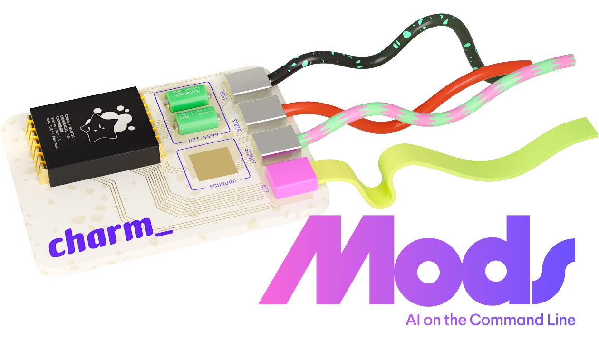

> [!NOTE]
> #### Actively Maintained Fork
>
> The original Mods was [sunset by Charm](https://github.com/charmbracelet/mods) on
> March 9, 2026. **This fork** is actively maintained with new features and fixes.

# Mods

<p>
    
    <br>
    <a href="https://github.com/panjie/mods/actions"></a>
</p>

An AI agent for your terminal. Mods reads and edits files, runs shell commands,
searches the web, and chains tool calls until the job is done — with a review
step before anything risky.

**Self-contained by design.** Mods is one Go binary. Its built-in tools run
in-process: no Python, OCR or ASR service, ffmpeg, or nested `mods`/model process
is required to read and edit files, run commands, or work with native image,
audio, and video input. Network access is explicit: the model provider, prompts
loaded from a URL, opt-in web search, `http_download`, and MCP servers you
configure. Portable mode can keep the binary, config, and sessions in a single
folder you can copy anywhere.

**Ask Mods how to use Mods.** Questions about Mods itself are answered from
version-matched self-help generated from the running binary's real flags and
settings, not from stale docs:

```sh
mods "how do I add a custom OpenAI-compatible provider?"
mods "what is the difference between review-mode auto and always?"
mods "where are my sessions stored, and how do I make this install portable?"
```

With a tool-capable provider and tools enabled (the default setup), Mods calls
its `mods_help` tool, so it can check what your version actually supports
instead of inventing options. Prefer local references? Run `mods --help`,
`mods --list-tools`, or `mods --dirs`.

Mods works with [OpenAI], [Anthropic], [Gemini], [Azure OpenAI], [DeepSeek],
[GLM], [Qwen], [Kimi], [MiniMax], [OpenRouter], and local [Ollama] models. Any
OpenAI-compatible endpoint can be added in `mods.yml`.

[OpenAI]: https://platform.openai.com/account/api-keys
[Anthropic]: https://console.anthropic.com/settings/keys
[Gemini]: https://aistudio.google.com/apikey
[Azure OpenAI]: https://azure.microsoft.com/en-us/products/cognitive-services/openai-service
[DeepSeek]: https://platform.deepseek.com/api_keys
[OpenRouter]: https://openrouter.ai/settings/keys
[Ollama]: https://ollama.com
[GLM]: https://open.bigmodel.cn/
[Qwen]: https://dashscope.console.aliyun.com/
[Kimi]: https://platform.moonshot.cn/
[MiniMax]: https://www.minimaxi.com/

<p></p>

## Quick Start

### Install

```sh
brew install panjie/tap/mods
```

Or, with Go 1.25.8+:

```sh
go install github.com/panjie/mods@latest
```

Release builds are static Go binaries; the built-in toolset needs no extra
runtime.

<details>
<summary>Other ways to install</summary>

Build from source with [Task](https://taskfile.dev):

```sh
git clone https://github.com/panjie/mods.git
cd mods
go run github.com/go-task/task/v3/cmd/task@v3.51.1 build        # binary lands in bin/mods
go run github.com/go-task/task/v3/cmd/task@v3.51.1 install      # installs to ~/.local/bin/mods (or $XDG_BIN_HOME)
```

The `install` task honors `PREFIX`, `BINDIR`, `DESTDIR`, and `XDG_BIN_HOME`.
On all platforms the default install path is `$HOME/.local/bin/mods` (`mods.exe` on Windows).

Prebuilt Windows portable ZIPs are published on the [releases] page.
The latest nightly build is published as the [nightly prerelease].

[releases]: https://github.com/panjie/mods/releases
[nightly prerelease]: https://github.com/panjie/mods/releases/tag/nightly

Generate shell completions:

```sh
mods completion bash > mods.bash
mods completion zsh > _mods
mods completion fish > mods.fish
mods completion powershell > mods.ps1
```

</details>

### Configure

Run the interactive setup wizard to pick a provider, model, and API key:

```sh
mods --config
```

The wizard walks you through provider and model selection, API key entry,
built-in tools, and review mode, then saves everything to `mods.yml`
automatically.

The standard config path is `$XDG_CONFIG_HOME/mods/mods.yml`, or
`$HOME/.config/mods/mods.yml` when `XDG_CONFIG_HOME` is unset. Sessions are
stored in `$XDG_DATA_HOME/mods/sessions`, or `$HOME/.local/share/mods/sessions`
when `XDG_DATA_HOME` is unset. If a `mods.yml` exists next to the executable,
[portable mode](#portable-mode) uses that file instead.

On first real use, if `mods.yml` does not exist and there are no saved
sessions, Mods starts this wizard automatically. Help, version, completion,
directory, settings, config, and list commands do not trigger first-run setup.

Prefer to edit the raw YAML? Open it in `$EDITOR`:

```sh
mods --settings
```

You can also recursively merge a YAML mapping into `mods.yml` from the command
line. Existing values at the same path are overwritten, while unmentioned
settings are preserved:

```sh
mods --settings 'default-api: openai'

mods --settings 'apis:
  fujitsu-google:
    api-type: google
    base-url: https://abc.com
    api-key-env: FUJITSU_GOOGLE_API_KEY
    models:
      gemini-3.0-pro: {}'
```

The `--settings='<yaml>'` spelling is also supported. Avoid passing `api-key`
values directly because command arguments may be recorded in shell history or
visible to other local processes; prefer `api-key-env`.

A minimal provider configuration looks like this:

```yaml
default-api: openai
default-model: gpt-5.4
apis:
  openai:
    api-key-env: OPENAI_API_KEY
    models:
      gpt-5.4: {}
```

```sh
export OPENAI_API_KEY=sk-...
```

See [Provider details](docs/providers.md) for custom endpoints, routing, and
provider-specific reasoning options.

### First Run

```sh
# Summarize piped output
git log --oneline -20 | mods -f "group these commits by theme"

# Let Mods read and edit files in the current directory
mods "read README.md and suggest three improvements"
```

## What Mods Can Do

- **Act, don't just talk.** With tools enabled, Mods inspects and edits files,
  runs shell commands, and chains tool calls to complete a task end-to-end.
- **Review before risk.** Reads run without review. Mutating writes and commands
  follow the review policy: approve once, deny, or save a per-session rule.
- **Fit your pipeline.** `--minimal` prints only the final answer, with no
  formatting — ready for `| gum choose`, `jq`, or another script.
- **Search the live web.** Web search is opt-in. `--web-search` uses a supported
  provider's hosted search when available, otherwise Tavily, DeepSeek, or a custom backend.
- **See and hear media.** Pass images, audio, or video with `--image`, `--audio`,
  or `--video`; Mods reads local files directly into a capable model.
- **Remember everything.** Sessions are saved locally with a title and a short
  ID, then listed, resumed, or deleted from a browser.
- **Extend without rebuilding.** Use [MCP](#mcp) servers, [custom roles](#custom-roles),
  prompt overrides, and [skills](#skills).

## Examples

### Review and Refactor

```sh
# Review uncommitted changes before pushing
git diff | mods -f "review this diff — flag bugs, security issues, and naming problems"

# Migrate a codebase from one library to another
mods "replace all requests usage with httpx, keep behavior identical"

# Sweep the repo for stale patterns
mods "find every console.log and replace it with the structured logger"
```

### Debug and Understand

```sh
# Diagnose why tests are failing
go test ./... 2>&1 | mods "explain each failure and suggest the likely fix"

# Make sense of a messy log tail
journalctl -u myapp --since "1h ago" | mods "what went wrong in the last hour?"

# Get up to speed on an unfamiliar codebase
mods "read internal/tools and explain how a tool call flows end-to-end"
```

### Generate and Automate

```sh
# Draft a changelog from recent commits
git log v1.0.0..HEAD --oneline | mods "write a user-facing changelog grouped by theme"

# Add tests for the most important untested functions
mods "find Go functions without tests and add table-driven tests for the top 5"

# Collect every TODO into a prioritized report
mods "scan for TODO/FIXME comments and write prioritized TODO-report.md"
```

### Pipelines and Sessions

```sh
# Pick from a list using pipeline-friendly output
find . -maxdepth 1 -type f | sort | mods --minimal "pick the five most important files" | gum choose

# Ask the live web, then act on the answer
export TAVILY_API_KEY="tvly-..."
mods --web-search "what changed in the latest Go release? update go.mod if relevant"

# Save, resume, and continue in a chat
mods "draft v1.1 release notes from CHANGELOG.md"
mods --continue-last "turn those into a Twitter thread"
mods --list-sessions
mods --chat
```

### DeepSeek Search

Select DeepSeek in `mods --config`, or add these settings to `mods.yml`:

```yaml
web-search: true
web-search-provider: deepseek
web-search-api-key-env: DEEPSEEK_API_KEY
```

Set `DEEPSEEK_API_KEY` to your DeepSeek API key, or store the key in
`web-search-api-key`. The search backend is independent of the chat model and
uses the [DeepSeek Search API](https://api-docs.deepseek.com/api/search/).
Results include titles, URLs, and model-oriented summaries. Queries support
DeepSeek's search operators and must fit its 128 Unicode character limit.
Provider-hosted search still takes precedence when the selected chat endpoint
supports it (for example, DeepSeek Responses).

To run a live search smoke test with `DEEPSEEK_API_KEY` set:
`go test -tags integration ./internal/websearch -run TestDeepSeekSearchIntegration -count=1 -v`.
This sends one real search request; ordinary tests do not call the service.

## Safety & Review

Reads proven by static analysis or explicitly trusted configuration run without review, including reads
from any local directory and reads whose path is resolved only at runtime.
Writes are reviewed by target by default.

In the default `auto` mode, non-temporary writes require approval unless
session rules already cover every write target. Choose `Allow for session`
to save permissions for directory subtrees and exact remote origins. These
rules are restored with `--continue` and are never shared with another session.
With `--no-save`, they last only for the current run.

Writes not covered by the current review policy require confirmation. You see
what will execute and which write targets the decision covers:

```
Review: Run: rm -f /path/to/project/demo.gif
[Y] Approve  [N] Deny  [A] Allow for session  [Ctrl+C] Cancel
```

- `Y` — approve this one call
- `N` — deny; Mods gets the failure and can react
- `A` — in `auto` mode, save per-session rules for every shown directory and
  remote origin so matching writes skip later prompts
- `Ctrl+C` — cancel the whole run

`Allow for session` is available only when every write target can be identified.
Unknown effects or incomplete write targets can be allowed once, but cannot be
saved. Finding one path does not bound the rest of a command. Command assessment
uses deterministic analysis; no LLM classifier is involved. Remote rules use a credential-free origin such as
`https://api.example.com` or `ssh://github.com`; paths, queries, fragments, and
credentials never appear in the saved rule. Writes confined to Mods' safe
temporary directories do not require review only when the complete write scope
is proven. A script's location does not authorize its effects. Native file writes
are approved against real paths, including symlink/junction targets, and are
rechecked before execution. Git reviews include all known push destinations;
unmodeled hooks or helpers require approval for each call.

Write targets that still depend on runtime expansion (for example PowerShell's
`$PROFILE` or a URL stored in a variable) are shown as dynamic and can only be
approved once. For a reusable approval, resolve the target first and use its
literal value in the mutation command. Dynamic reads do not require review.

Pick the mode that fits the task with `-V` / `--review-mode` (or `review-mode`
in `mods.yml`, or the `MODS_REVIEW_MODE` env var). Use `-N` / `--no-review` as
a shortcut for `--review-mode=never`:

| Mode     | Behavior |
|----------|----------|
| `auto`   | Default. Reviews non-temporary writes unless existing session rules cover every target. |
| `always` | Reviews every non-temporary write and ignores saved rules. Reads stay free. |
| `never`  | Disables review entirely. Use only for trusted, automated runs. |

```sh
mods --review-mode always "rename the fn to calculateTotal across the repo"
```

Review is an approval policy, not an execution sandbox. Use a container or VM
for untrusted code.

On Windows, command tools (`process_run`, `powershell_run`, and `shell_run`)
accept `elevated: true` when one command needs administrator privileges. Mods
reviews the original command and targets first, then requests Windows UAC
consent or administrator credentials. Only that command runs elevated; output
and exit status return to the conversation. Saved target rules still apply,
and `--no-review` does not bypass UAC. Neither Windows sudo nor an elevated Mods
session is required.

UAC consent time counts toward the command timeout. Canceling or timing out
disconnects the helper and stops its command tree. Windows may leave a pending
consent dialog visible; accepting it after cancellation cannot start the command.
Enter administrator credentials only into Windows' UAC dialog, never into chat.
An already elevated Mods session uses its existing privileges without another
UAC prompt.

## Tools & MCP

Mods ships its complete toolset in the binary. Filesystem tools auto-activate
when a request needs them; shell tools are enabled by default.

| Built-in | What it does |
|----------|--------------|
| `fs_*` | Read, search, write, replace, patch, move, copy, and delete files. |
| `process_run` | Run one executable with a literal argv and structured output. |
| `shell_run` / `powershell_run` | Run shell syntax: pipelines, redirection, compound commands. |
| `runtime_info` | Report the OS, cwd, selected shell, and command availability. |
| `http_download` | Download up to 32 explicit URLs without a shell. |
| `web_search` | Search the web (requires `--web-search`). |
| `fs_find_images` / `fs_find_media` | Find image, audio, and video candidates recursively. |
| `fs_read_images` / `fs_read_media` | Read original media into the current model. |
| `todo_write` | Keep a visible plan for multi-step work. |
| `request_user_input` | Ask a necessary question with a compact local dialog. |
| `load_skill` / `search_skills` | Load installed [skills](#skills). |
| `mods_help` | Version-matched help for Mods itself. |

Run `mods --list-tools` for the full catalogue, including any MCP tools.

Filesystem paths resolve from the process current working directory. Shell and
process tools start there by default and accept a per-call `cwd` argument. The
status line shows what Mods is doing between tool calls ("Reading file: ...",
"Running command: ...", "Searching web: ..."). Hide it with
`--hide-tool-status`, which also suppresses the compact one-line record each
completed tool call leaves in normal output (for example
`> ✓ shell_run: ls -la · exit 0`).

Filesystem tools default to `auto`; shell is enabled by default. Toggle them in
`mods.yml`:

```yaml
builtin-tools:
  filesystem: auto          # auto, true, or false
  shell: true
  shell-timeout: 60s        # default timeout; per-call timeout_ms may override
```

Command complexity is diagnostic information, not a reason to retry or rewrite
an invocation. Commands proceed directly to ordinary effect and target approval,
including in minimal mode. Related reads and aggregations can share a pipeline
or readable script; Mods encourages reusing results for totals and breakdowns.
Existing scripts run unchanged once authorized. New multi-step scripts can live
in the supplied temporary directory, but that location does not grant permission
for their execution effects. Explicit `--review-mode never` bypasses review.

Git HTTP(S) authentication can prompt in the terminal and continue the same
command when needed; passwords are masked, passed over local IPC, and never sent
to the model or saved by Mods. Debug traces (`-D`/`--debug`) and token counts
(`-s`/`--show-token-usage`) go to stderr. See [Tool details](docs/tools.md) for
reviewability, `http_download`, Git authentication, and debug output.

### MCP

Connect external tools and data sources through
[Model Context Protocol](https://modelcontextprotocol.io) servers configured
under `mcp-servers` in `mods.yml`:

```yaml
mcp-servers:
  github:
    command: docker
    env:
      - GITHUB_PERSONAL_ACCESS_TOKEN=xxxyyy
    args:
      - run
      - "-i"
      - "--rm"
      - "-e"
      - GITHUB_PERSONAL_ACCESS_TOKEN
      - "ghcr.io/github/github-mcp-server"
```

Inspect what's available with `mods --list-mcps` and `mods --list-tools`. MCP is
optional: everything built into Mods works without it.

### Skills

Skills are folders with a `SKILL.md` that teach Mods a workflow. They load on
demand, so only matching instructions enter the context. Mods loads skills
from the configured directories and does not ship built-in skills.

```sh
mods --list-skills
mods --skills-dirs ~/.agents/skills --list-skills
```

Install skills under `~/.agents/skills`, or add directories with `--skills-dirs`.
Later directories override same-name skills. Portable installs also read a
`skills/` directory beside the executable.

## ChatGPT subscription

Run `mods --config`, select **chatgpt**, and choose **Continue with ChatGPT**.
Your system browser opens automatically. Grant plan usage there, then
return to mods to select an account-provided model. The connection check sends a
small inference request using your plan allowance. No API key is required.
If the browser cannot be opened, mods displays the authorization URL as a fallback.

Account management is also available without the wizard:

```sh
mods --chatgpt-auth login                 # add an account/workspace
mods --chatgpt-auth list                  # show registrations; * marks the active one
mods --chatgpt-auth use:<client-id>        # switch the active registration
mods --chatgpt-auth login:<client-id>      # renew a saved registration
mods --chatgpt-auth logout                # sign out of the active registration
mods -a chatgpt -m <configured-model> "Hello"
```

Each workspace registration has its own client ID and credentials. After
switching accounts, rerun `mods --config` to refresh the model choices. Access
tokens refresh automatically, including between tool rounds. Tokens live in
`$XDG_CONFIG_HOME/mods/chatgpt/accounts.json` (or the OS user configuration
directory when unset), separately from `mods.yml` and conversation history.
This storage stays local even when using a portable configuration. Protect this
credential file; it is written with owner-only permissions on Unix. Logout
attempts remote session revocation and clears local tokens while retaining the
registration and host ID. If revocation cannot be confirmed, disconnect mods
in ChatGPT Settings.

This uses OpenAI's official **Sign in with ChatGPT** preview for local open-source
apps and the public Responses endpoint. Account/workspace eligibility and plan
limits apply. Text, images, local tools and MCP function tools use the existing
mods approval flow. This route does not support audio/video input or hosted
Responses tools such as image generation, file search and Code Interpreter.
Unsupported sampling/output-limit parameters are omitted, and complete context
is sent with each request (`store: false`). Usage-limit failures do not fall back
to API-key billing.

Protocol references: [registration and sign-in](https://developers.openai.com/siwc/token-sharing-open-source/sign-in),
[accounts and sessions](https://developers.openai.com/siwc/token-sharing-open-source/profiles-and-sessions),
[preview limitations](https://developers.openai.com/siwc/token-sharing-open-source/preview-limitations).

## Supported Providers

Mods is configured for the providers below out of the box. The easiest way to
get started is `mods --config`; you can also set the matching environment
variable and select a model with `--api` and `--model`.

| Provider     | `--api` value  | Env var                      | Get a key                                     |
|--------------|----------------|------------------------------|-----------------------------------------------|
| OpenAI       | `openai`       | `OPENAI_API_KEY`             | [platform.openai.com][OpenAI]                 |
| Anthropic    | `anthropic`    | `ANTHROPIC_API_KEY`          | [console.anthropic.com][Anthropic]            |
| Google       | `google`       | `GOOGLE_API_KEY`             | [aistudio.google.com][Gemini]                 |
| Azure OpenAI | `azure`        | `AZURE_OPENAI_KEY`           | [azure.microsoft.com][Azure OpenAI]           |
| DeepSeek     | `deepseek`     | `DEEPSEEK_API_KEY`           | [platform.deepseek.com][DeepSeek]             |
| OpenRouter   | `openrouter`   | `OPENROUTER_API_KEY`         | [openrouter.ai][OpenRouter]                   |
| Ollama       | `ollama`       | — (local)                    | [ollama.com][Ollama]                          |
| GLM          | `glm`          | `ZAI_API_KEY`                | [open.bigmodel.cn][GLM]                       |
| Qwen         | `qwen`         | `DASHSCOPE_API_KEY`          | [dashscope.console.aliyun.com][Qwen]          |
| Kimi         | `kimi`         | `MOONSHOT_API_KEY`           | [platform.moonshot.cn][Kimi]                  |
| MiniMax      | `minimax`      | `MINIMAX_API_KEY`            | [www.minimaxi.com][MiniMax]                   |

Direct requests to `api.openai.com` use the Responses API by default for every
model and feature; set `endpoint: chat-completions` on a model to override.
Mods sends `store: false` and keeps the encrypted response items needed for
stateless reasoning and tool continuation in its local session data. Azure
OpenAI, custom base URLs, and other OpenAI-compatible providers continue to use
Chat Completions.

Official `deepseek-flash`, `deepseek-v4-flash`, `deepseek-v4-flash-vision-exp`,
and `deepseek-v4-pro` requests to `api.deepseek.com` also use the
[DeepSeek Responses API](https://api-docs.deepseek.com/zh-cn/guides/responses_api)
automatically. DeepSeek Responses is stateless, so complete response items and
tool outputs remain in the local session and are replayed on the next turn.
DeepSeek Flash accepts image attachments and images returned by tools on both
Responses and Chat Completions; DeepSeek Pro does not accept image input. Set
`endpoint: chat-completions` on the model to opt out.

Three independent settings control routing:

- `api-type` chooses the transport adapter (`openai`, `anthropic`, `google`,
  `ollama`, or `azure`).
- `provider-profile` chooses provider-specific semantics on an OpenAI-compatible
  transport (`openai`, `deepseek`, `qwen`, `glm`, `kimi`, or `minimax`). A
  model-level value overrides the provider default.
- `endpoint` chooses `responses` or `chat-completions` for a model on an
  OpenAI-compatible transport.

Unknown enum values are rejected instead of silently falling back. Custom
providers must configure `base-url`; only built-in providers with a known
official endpoint may omit it. When web search is enabled, an endpoint with
hosted search capability uses it automatically; other endpoints keep the
existing local search behavior.

`-t` / `--think` enables reasoning where supported. Exact effort values remain
model- and provider-dependent, and unsupported configured values fail before the
HTTP request. See [Provider details](docs/providers.md) for custom gateways,
thinking controls, and per-provider behavior.

```sh
mods --api anthropic --model claude-sonnet-4-6 "explain this error"
mods --api glm --model glm-5.2 "把这个日志总结成中文要点"
mods --api ollama --model llama4 "summarize this log"
```

## CLI & Configuration

```sh
mods [OPTIONS] [PROMPT...]

mods --help                 # all options, grouped by purpose
mods --config               # interactive setup wizard
mods --settings             # open mods.yml in $EDITOR
mods --settings '<yaml>'    # recursively merge YAML into mods.yml
mods --dirs                 # show config and session paths

mods --list-sessions        # browse saved sessions
mods --list-tools           # built-in and MCP tools
mods --list-skills          # installed skills
mods --list-roles           # custom roles
mods --list-prompts         # built-in prompts and overrides
mods --list-mcps            # configured MCP servers
```

The setup wizard keeps edits when you go back or switch providers, and saves
only after you confirm the final summary. Use Enter to continue, Esc to go back,
and Ctrl+C to cancel. Outside text inputs and filters, `j`/`k` move down/up and
`q` cancels without saving. In model lists, Space selects, `/` filters, `r`
retries discovery, and `m` switches to manual entry. Use Ctrl+J for a new line in
manual model input and Page Up/Page Down to scroll long content. The heading
shows the current step, and the action row stays in place while discovery runs.
Discovery failures include retry and manual-entry guidance.

Help starts with common examples and groups advanced flags after everyday
options. Descriptions wrap to the terminal width; all public flags remain listed.

Most advanced defaults (model parameters, themes, MCP, debug, format hints) live
in `mods.yml` and are documented inline. Run `mods --reset-settings` to back up
the current file and restore the defaults.

### Sessions & Chat

Every session is saved locally with a title and a short ID. `--continue` resumes
a session by ID or title; `--continue-last` resumes the most recent one.
`--list-sessions` opens a full-width, single-column browser. Each session occupies
one row with its short ID, title, model, provider, and update time.
Press `/` to filter sessions, `Enter` to open the full transcript, and `c` to
continue the selected conversation. Space marks sessions; `d` deletes the focused
session and `D` deletes marked sessions after confirmation. Inside a transcript,
`/` searches text, `n`/`N` moves between matches, `w` toggles wrapping, and `Esc`
returns to the list.

During a response, consecutive successful file reads collapse into a summary.
`Ctrl+O` toggles tool arguments and output previews; failures show a short
preview automatically. Live previews are bounded; saved sessions retain the
complete tool results. `Ctrl+P` expands the plan, where Up/Down scrolls through
steps. Press `Ctrl+P` again to return to the compact current-step view. These
shortcuts yield to approval dialogs and input forms.

`--chat` starts a continuous conversation. Press `Enter` for a newline,
`Ctrl+Enter` or `Ctrl+S` to send, and `Ctrl+C` while composing to leave. Each turn is saved to the
same session so you can resume it later with `--continue`.

### Portable Mode

Put a `mods.yml` next to the `mods` executable. Config and sessions then live in
that folder instead of the XDG locations, and a `skills/` directory beside the
executable is loaded as well. The folder can be copied as a self-contained
install. Run `mods --dirs` to see the active paths.

### Custom Roles

Roles are reusable system prompts. Define one in `mods.yml`:

```yaml
roles:
  shell:
    - you are a shell expert
    - you do not explain anything
    - you simply output one liners to solve the problems you're asked
    - you do not provide any explanation whatsoever, ONLY the command
```

Then use it:

```sh
mods --role shell "list the largest files in the current directory"
mods --list-roles
```

### Prompt Overrides

Built-in runtime prompts can also be overridden in `mods.yml`. Run
`mods --list-prompts` to print the available keys and their default text, then
copy the one you want to customize:

```yaml
prompts:
  workflow: |
    Follow the task through implementation and verification.
    Explain the result and any remaining uncertainty.
```

The removed `prompts.shell-classifier` and `shell-classify-prompt` settings are
ignored in existing configuration files and can be deleted.

## Images, Audio, and Video

Mods reads media natively and sends it straight to the model — no OCR, ASR,
ffmpeg, or nested `mods` process:

```sh
mods --image assets/mods-product.png "suggest alt text for this image"
mods -I "describe the image on my clipboard"
mods --audio meeting.wav "summarize the decisions in this recording"
mods --video meeting.mp4 "list the action items and who owns each one"
```

`--image`, `--audio`, and `--video` are repeatable and can be combined. Direct
attachments do not need filesystem tools. Automatic discovery and reading
through `fs_find_images`/`fs_read_images` and `fs_find_media`/`fs_read_media`
do; `auto` is the default and recognizes media requests, while
`builtin-tools.filesystem: false` disables them. Describe what you are looking
for and Mods enumerates candidates, reads the originals, and reports matches,
non-matches, and uncertain cases.

- Up to 8 files per media read.
- Images: up to 64 per request and 20 MiB of raw image data.
- Audio: WAV/MP3, 6 MiB and 10 minutes per file, 4 per read, 15 minutes total.
- Video: non-fragmented H.264/AAC-LC MP4, 6 MiB, 2 minutes, and 1080p per file,
  1 per read, 5 minutes total.
- Saved and current input share 20 MiB of raw media and a 40 MiB serialized
  request budget.

Adapters expose media according to their implemented protocol, without a
model-name allowlist or per-model media settings. If a model cannot understand
an attachment, the service rejects it; Mods preserves that error instead of
silently dropping the file. For formats, sampling, pagination, and uncertainty
details, see [Media details](docs/media.md).

## Contributing

Issues and pull requests are welcome on this fork. Before opening a PR, run:

```sh
go run github.com/go-task/task/v3/cmd/task@v3.51.1 check   # compile everything
go run github.com/go-task/task/v3/cmd/task@v3.51.1 test    # run the test suite
```

CI runs the same build and test baseline on Linux, macOS, and Windows. See
[Development](docs/development.md) for linting, focused tests, real-AI black-box
scenarios, and the Windows reliability suite.

## License

[MIT](https://github.com/panjie/mods/raw/main/LICENSE)
