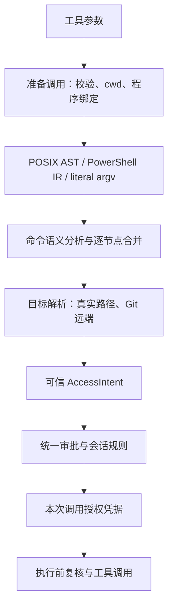

# 命令审批核心重构设计

日期：2026-10-22  
状态：四项 P1 与审批主链路重构已实施；2026-10-23 Windows 本地构建和全量根模块测试通过。跨平台 CI / race 尚未执行。  
范围：优先修复本轮评审确认的四个 P1；不引入沙箱。  
实施计划：[分阶段实施计划](../plans/2026-10-22-command-approval-refactor.md)。

## 1. 目标与约束

保留 `requestApproval` 单一审批入口、目录/origin 会话规则、现有审批 UI 和工具调度框架。重构事实表达、组合分析、目标解析和执行授权传递，使自动放行必须具有可说明的依据。

核心不变量：

1. 找到若干目标，不代表已找到全部目标。
2. 一个子调用未知，不能被其他子调用的已知写目标覆盖掉。
3. 命令评审只使用确定性事实，不包含 LLM 分类或建议路径。
4. 已保存规则只有在全部写目标可确定时才参与放行；人工单次批准可接受明确展示的不确定性。
5. 审批与执行使用相同的目标语义、真实路径和调用参数；工作目录只提供解析上下文，不产生写权限。
6. 复杂度只用于诊断。复杂命令原样进入普通审批，不强制拆分、不增加纠正预算、不新增脚本执行工具。
7. `never` 保留显式关闭审批的语义；参数校验、工具自身路径检查、UAC 和超时仍生效。
8. normal/minimal 使用同一授权策略；纯读取保持现有位置无关的免审语义。

本方案保证审批决策与已建模事实一致，并加强原生文件工具的运行时检查。没有沙箱时，不承诺限制任意外部程序的全部系统调用、子进程、网络访问或审批后的所有竞态。`complete` 必须注明其成立的语义模型和前提，不能解释为对任意程序的行为证明。

## 2. 已确认问题与验收目标

| 编号 | 已复现场景 | 根因 | 修复后的最低要求 |
| --- | --- | --- | --- |
| P1-1 | `uniq in out`、`xxd in out`、`git reflog expire --expire=now --all` 被标为静态只读 | 命令名/第一层子命令覆盖了可写参数语义 | 这些调用不能免审为 read；支持的写形式提取真实目标，其余按不完整写处理 |
| P1-2 | `unknown-writer > <temp>/log`；已知临时写后跟未知调用 | 收集器仅累计已知目标，丢失未建模副作用 | 保留未知部分；临时目录与会话规则均不能放行整个调用 |
| P1-3 | 多 pushurl、默认远端、多个 push、`--repo` | 正则只取首个匹配；默认猜测 origin；只查询一个 URL | 所有实际远端均进入目标集；无法可靠求值时明确标为不完整 |
| P1-4 | 仅授权 `allowed`，经其中 junction 写入同级 `other` | 审批按字面路径；执行把整个 cwd 当成写边界 | 审批使用实际目标；执行按本次批准范围复核；未授权 `other` 不发生写入 |

P1-1/2/3 已通过隔离分析及规则匹配验证；P1-4 已通过 Windows junction 和真实原生文件工具在临时目录中验证。实施后的永久回归见 `internal/app/approval_regression_test.go`；新增准备/凭据与覆盖率测试分别位于 `internal/tools/prepared_access_test.go` 和 `internal/approval/facts_test.go`。

## 3. 目标架构与模块职责



| 责任 | 模块 | 边界 |
| --- | --- | --- |
| 语法解析、语义规则、合并 | `internal/approval` | 保留两种 shell 解析器；逐步共享 invocation 事实；不调用模型或执行待审命令 |
| 环境/路径/Git 查询编排 | `internal/app/shell_assess.go`、目标解析 helper | 使用有取消和预算的只读解析；结果必须带缺口，不凭猜测补全 |
| 路径规范化及链接语义 | `internal/pathutil` | 明确区分词法路径、真实路径、跟随/不跟随叶子链接 |
| 纯授权策略与规则 | `internal/approval/access.go`、`matching.go` | 只消费可信事实；统一决定是否需要询问、能否生成规则 |
| 人工交互 | `internal/app/review.go`、`review_*` | 展示相同事实和候选授权范围；返回决策及本次凭据 |
| 调用编排与凭据注入 | `internal/app/request_session.go` | 审批成功后注入权限，启动执行超时，复核后执行 |
| 原生文件写入检查 | `internal/tools` | 读能力和写能力分离；写入不因处于 cwd 就获得权限 |
| 会话存储 | `internal/session` | 本轮不增加授权类型、不迁移数据库；继续保存已有目录/origin 规则 |

不一次性建立全新 shell IR。先让已有 AST 和 PowerShell IR 输出同一种 invocation 事实，保留方言特有的控制流、展开和 provider 语义；不能通过字符串切分模拟解析。

## 4. 事实契约

以下为建议的接口形状，实施时允许调整名称，不允许削弱语义：

```go
type EvidenceKind uint8
const (
    EvidenceUnknown EvidenceKind = iota
    EvidenceDeterministic
    EvidenceExplicitTrust
)

type TargetCoverage uint8
const (
    CoverageIncomplete TargetCoverage = iota // 零值禁止自动复用写规则
    CoverageComplete
)

type AssessmentGap struct {
    Code string // unknown-invocation / unresolved-remote / path-context 等
    // 实施时带节点定位与脱敏说明；原始参数不进入诊断日志。
}

type CommandAssessment struct {
    Effect        CommandEffect
    Evidence      EvidenceKind
    WriteCoverage TargetCoverage
    Gaps          []AssessmentGap
    // 保留已知目录、远端、动态目标、provider、shape 等现有事实。
}
```

`StaticRead` 在过渡期由 effect/evidence 推导，避免出现两套独立真值。用户配置的 `ShellReadOnlyCommands` 是明确的信任声明，标记为 `EvidenceExplicitTrust`；保留其现有兼容语义，但不伪装为内建证明。

2026-10-23 根据后续决定，完整删除 LLM 分类器、结果解析、缓存、建议模型与展示入口，以及相关提示词和配置字段。未知命令直接保留未知事实并进入普通审批。旧配置文件中的已移除字段由 YAML 常规未知字段行为忽略，不再进入配置结构或生成的默认模板。局部配置编辑可能保留旧 YAML 文本，但这些字段不再生效。

`AccessIntent` 增加相同语义的 `WriteCoverage` 和结构化缺口；它只接收可信部分。`UncertainEffect` 不再被用作目标是否完整的替代字段。未知 effect 的一般外部命令默认 coverage 不完整；只有专门分析器能明确给出完整的潜在写范围时，才允许未知 effect 配合完整范围。

零值迁移需要同时覆盖所有生产者：原生文件工具、download、shell/process、MCP 和测试 helper。禁止根据“目录非空”自动设为 complete；未知或未注册的 extractor 保持 incomplete。原生工具依靠其实现契约声明范围；MCP 保留现有服务声明的信任模型，HTTP/SSE 的 endpoint 仅表示已信任的服务授权域，不宣称证明服务内部副作用；stdio 可变工具保持不可复用。MCP 的新信任制度不在本轮范围。

## 5. 组合分析与只读识别

按语法树的执行节点组合事实，保留原始调用顺序和定位：

- 全部可执行部分均为可信只读，整体才是可信只读。
- 存在明确写操作，整体 effect 可为 write；任何未建模部分使 coverage 为 incomplete。
- write coverage 为所有可能执行部分的保守合并；未知部分不能因另一个部分已有目标而消失。
- `;`、管道、`&&`、`||` 等按所有可能执行分支取影响范围并集，不执行条件以选择分支。
- 重定向增加一个文件写目标，不能证明被重定向程序的副作用。
- 未知循环、函数、解释器载荷、命令替换、PowerShell 方法调用和路径上下文变化保留缺口；已明确支持的纯只读结构可继续免审。
- 外部字面路径提取器只能增加候选/已知事实，不能消除缺口，不能宣称目标完整，也不能将读取源路径自动变成完整写范围。
- 字面赋值和环境变量物化只消除对应的路径缺口，不消除未知程序、钩子或远端缺口。每次 secret_env 的名称也参与前提检查。

命令语义分析器返回“支持的形式、effect、输入/输出角色、潜在写范围、未满足前提”。优先抽出文本工具、Git、文件写命令三个小分析器。无需插件框架或全量重写名单。

P1-1 首批处理：

- `uniq`/`xxd` 检查输出操作数和相关模式；只有支持的参数形式可确认只读；不认识的选项保守降级。
- `git reflog` 明确区分查询与修改，嵌套修改子命令不得继承只读分类。
- 避免修复仅发生在 POSIX 专用入口；`process_run`、POSIX shell、PowerShell 外部程序共享参数语义。
- 防止参数语义被 shell 引号、`--`、文件名中的空格和带前导 `-` 的操作数破坏。
- 可执行文件的信任前提失效、配置可能引入任意 hook/helper 时，不能仅因工具名称已识别就声称完整。普通构建、解释器、任意脚本继续单次审批。

## 6. 授权矩阵与决策结果

| 事实 | auto | always | never |
| --- | --- | --- | --- |
| 可信只读/现有显式只读信任 | 允许 | 允许 | 允许 |
| 写范围完整且仅在真实安全临时目录 | 允许 | 允许 | 允许 |
| 写范围完整，含普通目录/origin | 规则全部覆盖才允许，否则询问 | 询问，不复用规则 | 允许 |
| 写范围不完整、未知行为未限定 | 单次询问，不生成规则 | 单次询问 | 允许 |
| provider 写目标 | 保留单次询问 | 保留单次询问 | 允许 |

仅在 `auto`、coverage complete、没有 unresolved/provider 写目标且所有候选可稳定表示时生成规则。`ClassifyAccess`、`RulesAllowIntent`、`candidateRulesForIntent` 共用这一资格判定，不能各自维护近似版本。

`requestApproval` 最终返回一个内部 `ApprovalOutcome`（决策来源、命中范围、调用绑定），或错误。绑定已准备调用的不可变参数与目标快照；凭据按调用存活，不写入数据库。人工 Allow once 只授权本次调用，不能自动变成持久权限。

无交互终端时，确需询问的调用保持零执行并返回现有 review-unavailable 语义；不自动改成 `never`。拒绝、取消与缺少交互分别记录，未知命令不触发自动重写。

## 7. 文件路径准备与执行授权

本轮优先修复可稳定复现的链接越权，同时使全部原生写工具使用同一边界。

准备阶段新增可返回错误的路径准备接口。现有 `IntentExtractor` 为纯字面提取接口，无法表达解析失败；不得把 I/O 错误吞掉后回退到字面授权。建议为内建文件工具提供可选的 `PrepareAccess(ctx, args)` hook，返回 prepared access/intent，未实现的工具保持已有入口但不能隐式获得完整写能力。

每个本地目标保留：展示路径、绝对词法路径、实际作用路径、读写角色、链接跟随语义、用于批准的真实目录。先解析目标再求父目录，不能先丢掉叶子文件后再检查其链接。目标未创建时解析最近已有父目录；解析失败返回错误或不完整，禁止临时目录自动豁免。

| 操作 | 必须采用的目标语义 |
| --- | --- |
| 普通写入/替换 | 依据工具实际实现确定是否跟随叶子链接；授权实际写入对象及必要父目录 |
| 删除链接本身 | 解析父目录，不跟随叶子链接；授权删除链接目录项 |
| 移动/重命名 | 源与目标目录项均为写；跟随语义与系统操作一致 |
| 复制 | 源为读，目标为写；递归过程中不能因新遇到链接而扩大写范围 |
| mkdir/patch/download | 所有目标逐一准备；不存在路径用已有父目录；批次完整性保留 |

`ExecutionGrant` 将读取能力与写入能力分开。审批成功后再注入 context：

- `AuthorizedDirs` 的读取兼容用途可保留；它不能继续同时表示读取 cwd 与任意写能力。
- 原生写操作必须使用本次凭据的真实写目录；cwd 不提供默认写范围。
- 临时写豁免也生成限定到本次已解析目标的凭据，不授予整个临时目录的额外权限。
- `never` 跳过人工策略，但仍准备合法目标并生成本次执行凭据；不跳过现有参数和工具校验。
- 执行前重解析；如果目标改变且不在这次批准范围内，返回 typed stale-target 状态，在产生副作用前重新准备和审批。不得在工具内部自行扩大凭据或循环重试写入。
- 无写凭据的原生写入口不能以“位于 cwd”为理由默许；测试和内部调用显式使用测试/受信调用构造器。

新目录规则保存真实目录路径。旧规则保持可读；只做稳定的词法规范化，不把旧规则路径跟随当前 symlink/junction 重新绑定到新目标，也不因磁盘对象变为文件而把已存目录扩大成其父目录。旧别名规则不能匹配新真实目标时重新审批，不做数据库批量扩权迁移。

Shell 的已知写路径也按命令语义解析，无法确定跟随行为就保持 incomplete。审批后复核能发现稳定目标变化，但不能封锁 shell 启动后的任意路径竞态；基于文件句柄的全面竞态防护不作为本轮 P1 完成标准。

## 8. Git 远端解析

将现有正则查询改为“语法节点 → Git invocation → 目标解析结果”。POSIX/PowerShell 提供完整 invocation 列表；process_run 直接提供 literal argv。保留原始调用，不重写用户命令。

第一批必须支持并测试：

1. 显式 remote、显式 URL、`--repo value` 和 `--repo=value`。
2. 同一调用中每一条 push；本地 Git 配置若在前序语句中被改动，后续目标标为不完整，不能用执行前旧配置证明。
3. 多 pushurl：使用有界只读查询取得全部 push URL，逐项解析、去重；一个目标解析失败不能只保留其余目标并标为完整。
4. 默认远端选择：核对 Git 的分支相关配置、`remote.pushDefault` 等实际规则；首批无法覆盖的配置组合保持 unresolved，不默认猜 `origin`。
5. 正确处理受支持的 `-C`、引号和含空格路径；未知全局选项、`-c`、环境覆盖、remote helper/SSH 别名等可能改变语义的形式保持 incomplete，除非已有专门解析。
6. 本地路径 remote 进入本地写目标，不能当作未知网络主机或丢弃；不支持的本地仓库存储布局单次审批。

解析器返回 `origins + local write targets + gaps + context snapshot`，并传播到同一个 coverage 判定。URL 正则继续用于提示和脱敏，不能提供完整性证明。

Git helper 查询仅执行固定的只读子命令，使用可信且固定的 Git 路径、与调用一致的 cwd/有效配置上下文、总预算、输出上限及取消信号。不能为完成分类执行配置中的 hook、认证程序或任意工作区可执行文件。秘密环境导致上下文无法核实时保留缺口，不输出秘密。

已解析全部远端不等于已识别整个 Git 调用的副作用。hook、receive-pack/helper、配置变化等未限定执行行为仍使整体 coverage incomplete；不能仅凭 origin 完整就自动授权任意扩展行为。

等待批准后重读必要上下文和远端，变化时重新准备/审批，不悄悄增加 origin。无沙箱时不能保证所有 Git 配置在复核后永不变化，文档和 UI 不作此承诺。

## 9. 展示、兼容与审计

审批展示来自可信事实：原始命令、cwd、已知真实目标、未知范围及候选授权范围。路径别名与实际目标不同才同时展示，避免无意义重复。不展示模型猜测出的目标或行为。分页仍需展示全部内容才能批准。

记录：fact/evidence 来源、coverage、缺口代码、命中规则、批准目标、审批等待与分析耗时、执行前复核结果。首轮使用现有 debug/trace，不新增持久化审计数据库。只记录脱敏摘要，不保存 secret_env 值或带凭据 URL。

明确的兼容变化：

- 过去依靠 LLM read 免审的未知命令改为单次审批。
- 已知一个目录/origin 但副作用未限定的命令不再复用规则。
- 旧规则继续保留，不能因旧规则存在而跳过新的完整性检查。
- 路径链接跳转可能触发对真实目标的新审批。
- 保留显式只读信任、会话作用域、模式名称、读取免审、UAC 独立同意和审批后执行超时。

本方案实施时同步更新 `AGENTS.md`、现行 write-target/reviewability 设计和相关测试说明，明确取代其中“LLM 分类只读可直接免审”“未知副作用仅靠已知目标即可复用规则”的旧政策。只更新政策，不恢复命令复杂度拦截。

## 10. 完成标准

四项 P1 都必须具有永久的“分析 → 策略 → 实际 dispatch”回归；拒绝或无交互时记录实际执行次数为零。P1-4 在 Windows junction 和 POSIX symlink 上验证实际落盘位置；Git 测试只操作本地隔离仓库，不向外部推送。

保留普通读取与明确临时写的快速路径；原样执行已批准调用；规则覆盖必须是全部目标覆盖。全平台检查通过后才宣称跨平台完成，本地 Windows 结果不能替代 Linux/macOS CI。
