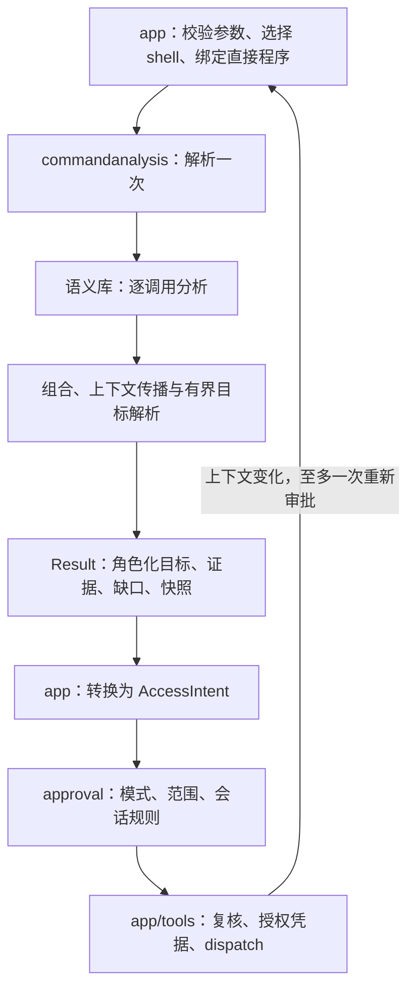

# 独立命令分析模块与统一命令语义库

> Superseded on 2026-10-28 by [model-declared command effects](../specs/2026-10-28-command-effect-declaration.md). This document records the retired analyzer/organization design; its historical results are unchanged.

日期：2026-10-23  
状态：设计已认可；阶段 0 基线、阶段 1 分析模块迁移已实施；阶段 2 共享解析/查询边界已实现并通过 Linux/race 验证，Windows 真实验收待补；统一语义库尚未实施。
实施计划：[分阶段实施计划](../plans/2026-10-23-command-analysis-catalog.md)。  
基础：[命令审批核心重构设计](2026-10-22-command-approval-refactor-design.md)。

## 1. 目标、范围与决策

将命令分析从应用编排和授权策略中独立出来，用同一个命令语义入口同时回答：调用是否写、读取什么、写入什么、写范围是否完整、哪些前提尚未满足。通过可回放样本定位并降低不必要审批，保留此前修复的安全边界。

本轮确定：

- 新增 `internal/commandanalysis`，不依赖 `app`、`approval`、`tools`、配置、会话数据库或模型 provider。
- 命令语义库采用编译进程序的 Go 类型化描述和专用分析函数；不引入 SQLite、热更新、用户可执行插件或通用规则 DSL。
- POSIX、PowerShell 和 literal argv 共享外部程序语义；shell 本身的语法、参数绑定和命令身份保持独立。
- 分开提交行为等价迁移与语义支持扩展；不得以重构为名扩大自动放行。
- 不恢复 LLM 分类、建议路径、模型调用、分类缓存或自动放行。未知调用继续普通审批。
- 保留 `requestApproval` 单一授权入口、会话目录/origin 规则、原生文件工具的 prepared access/UAC/超时语义。

非目标：通用静态程序分析、任意脚本解释、全 shell 解释器、沙箱、新权限模式、跨会话信任、数据库迁移、修改用户原始命令。新库不承诺识别所有命令，也不承诺约束 shell 启动后的系统调用。

## 2. 当前代码与问题定位

以下为当前工作树的结构观察，不代表已经测得线上误报率。

| 当前代码 | 当前职责 | 本轮问题 |
| --- | --- | --- |
| `internal/approval/assessment.go`、`shell_static.go` | shell/argv 分析入口、事实汇总、转 AccessIntent | 分析与授权契约在同一包，入口会重新组合多套命令判断 |
| `readonly.go`、`readonly_ps.go`、`readonly_policy.go` | 只读表、参数判断、用户信任 | 命令知识分散，用户信任与静态证明需要明确区分 |
| `writable_dirs.go` | 写操作数、PowerShell 别名和目录提取 | 过早压缩成目录；输入/输出/目录项角色不足 |
| `coverage.go` | 独立证明完整性、再次识别命令 | `boundedWriteInvocation` 与目标提取是不同集合 |
| `git_static.go`、`invocations.go` | Git 目录发现、再次枚举 shell 调用 | 与应用层远端解析共享的调用上下文不足 |
| `external_paths.go`、`posix_runtime_targets.go`、`scalar_subst.go` | 候选路径和动态表达式 | 字面候选不可成为写范围证明；需保存表达式来源 |
| `ps_bridge.go`、`ps_bridge.ps1`、`ps_probe.go` | PowerShell IR、引擎变量探测 | bridge 包含进程生命周期；IR 目前缺少完整节点关系和重定向目标绑定 |
| `internal/app/shell_assess.go` | 主编排、argv JSON 解码、事实合并、真实路径解析 | `Mods` 拥有过多分析职责，测试依赖 app |
| `stable_env.go`、`posix_env.go`、`literal_target.go` | 环境和字面赋值物化 | 分析输入隐含读取环境，不利于快照与回放 |
| `remote_targets.go` | Git 查询、URL 候选、UI 脱敏 | 领域分析与展示混合；Git 路径调用 `ShellInvocations` 再解析 |
| `request_session.go`、`review.go` | 程序绑定、准备、审批、写调用重评估 | 应保留生命周期，移除对具体 shell/命令规则的知识 |

具体例子：当前 `cp`/`mv` 有目标提取，但未进入完整写集合；且 `mv` 分支主要提取目的地，直接将它加入完整集合会遗漏源目录项修改。不能简单扩大名单修复体验。

`CommandAssessment.KnownDirs` 同时承载已知写目录及外部候选路径；`AccessIntent()` 将其按整体 effect 转换。混合读写命令容易把输入目录也当成写授权候选。新模型必须在语义源头保留角色，不能靠转换阶段猜测。

最近设计已经要求 incomplete 写不能复用授权。本轮保留这一规则，通过增加可核实的语义覆盖降低 incomplete，而不是把已知一个路径解释成完整。

## 3. 模块边界与依赖



建议初期保持一个实现包，以文件组织职责，避免提前建立插件框架或大量子包：

```text
internal/commandanalysis/
  input.go, result.go, engine.go, compose.go
  parse_posix.go, parse_powershell.go, parse_argv.go
  invocation.go, arguments.go, context.go
  catalog.go, catalog_validate.go
  commands_text.go, commands_filesystem.go, commands_git.go
  commands_powershell.go, commands_wrappers.go
  resolve_paths.go, resolve_env.go, resolve_git.go
  dependencies.go, snapshot.go, diagnostics.go
  ps_bridge.go, ps_bridge.ps1, ps_probe.go
  reviewability.go, script_file.go
  testdata/cases/, testdata/powershell/
```

`pathutil` 保留通用路径规范化和链接解析。命令专属目标解释、Git 仓库发现、有限查询及环境物化归分析模块。UI URL 脱敏留在 app；origin 规范化若需要复用，提取为无授权依赖的公共纯函数，而不是让分析模块导入 approval。

授权类型 `AccessIntent`、`RuleSet`、`ReviewMode`、匹配、候选规则资格继续由 approval 拥有。分析模块拥有自己的 Effect/Evidence/Coverage/Gap，app 的单一适配器显式映射到授权类型；拒绝不识别的枚举值，零值一律 unknown/incomplete。允许少量同义枚举，避免包循环及授权策略向分析器泄漏。

迁移中可暂时在 approval 保留类型别名/薄包装，依赖只能为 `approval -> commandanalysis`；包装不保留第二套实现。最终删除生产调用和不必要的兼容入口。非命令工具的 intent 契约不迁移。

## 4. 输入、输出和生命周期契约

建议公共入口（以下为设计接口，非当前已有 API）：

```go
func (e *Engine) Analyze(ctx context.Context, in Input) (Result, error)
func (e *Engine) Revalidate(ctx context.Context, in Input, old Result) (Validation, error)
```

Input 是有校验的 tagged union：shell source 和 direct argv 恰有一种。必须包含：

- 输入模式、shell 方言、实际 shell 身份/版本上下文、目标平台和路径语义；不可仅用宿主 `runtime.GOOS` 推导所有语义。
- shell 原文，或直接程序身份和完整 `[]string` argv；literal argv 永远不按 shell 插值，禁止拼成字符串再解析。
- 实际 cwd、工作区/临时目录身份所需的程序信任上下文；这些不是授权范围。
- 有效非秘密环境的按需只读快照，以及 secret_env 遮蔽名称；禁止记录秘密值。
- 现有用户显式只读信任配置的不可变副本，单独标记 evidence。

安全临时目录的免审决策由 approval 完成。分析模块只接收判断程序来源所需的“不可信可执行文件位置”等身份事实，不接收可用于放行的规则集合。

Result 包含：

| 字段 | 语义 |
| --- | --- |
| Effect | read / write / unknown；明确写与未知部分并存时可为 write，但必须 incomplete |
| Evidence | static / explicit trust / unknown；逐节点记录，整体保留使用过的信任来源 |
| Targets | 角色化资源目标，保留操作数到真实目标的关系 |
| WriteCoverage | complete / incomplete；无命令语义或未满足前提时默认 incomplete |
| Gaps | 节点、稳定代码、前提、脱敏说明；保留未知的局部来源 |
| Reviewability | 结构和脚本载荷诊断，不影响授权 |
| Dependencies | 本次分析依赖的程序、环境、路径与 Git 上下文快照 |
| Trace | 命中语义条目 ID/revision、解析和查询计数/耗时，不含原始秘密 |

Target 至少包含：Kind（filesystem/origin/provider）、Role（read/write/candidate）、Operation（read-content/write-content/create/remove-entry/rename-entry 等）、原始表达式/节点 ID、词法绝对路径、实际路径、授权目录、解析状态及 leaf-follow 语义。候选不是读或写的证明，不参与规则生成。

对于目录删除/重命名，既要表达目录内部影响，也要表达父目录中目录项的修改。不要仅把源或目标目录自身作为全部影响范围。普通文件复制保留源 read，移动保留源和目的 write。

Result 创建后按不可变值使用，复制 slice/map；复核返回新结果，不改写已批准结果。参数、规则 revision、可信程序绑定和依赖快照参与语义比较；耗时、诊断排序、展示文本不参与比较。

未知语法、未知选项、查询超时或 bridge 不可用属于可解释的 incomplete，继续现有普通审批。请求取消直接终止；输入契约错误及内部不变量破坏返回 error，不能伪装成可放行结果。分析器不会执行待审命令。

## 5. 统一解析与组合分析

一次 Analyze 内 POSIX 只构建一棵 AST，PowerShell 只请求一次解析 IR，argv 不经过 shell。允许多次只读遍历同一解析对象，不允许下游重新解析原文。

内部 ParsedCommand 保存节点 ID、源位置、执行关系、调用、重定向、赋值、表达式求值类型及上下文修改。不能只展平成 `[]string`：引用、展开、嵌套执行和标量参数必须可区分。

PowerShell bridge 的新版协议需要增加节点身份/父子关系、重定向操作与操作数、参数字面性/引用形态。协议有版本，Go 校验未知版本；旧字段可在过渡期保留，无法表达的节点继续产生缺口。协议 fixture 可跨平台回放，真实 bridge 在 Windows/可用 pwsh 主机验证。

合并规则：

1. 所有可能执行部分均为可信只读，整体才为 read；重定向和命令替换分别参与分析。
2. 已知写目标取并集。未知节点或不完整子调用不能被另一个 complete 子调用掩盖。
3. `;`、管道、`&&`、`||` 合并所有可能影响；不得执行条件来选择分支。
4. 上下文传播考虑执行关系。未知前序调用可能修改 cwd/配置/环境；后续查询不能使用旧状态证明目标。
5. 首批只支持明确的直线字面赋值及受支持的 cwd 变化；遇分支不一致时保留候选上下文或降级，不实现任意数据流求值。
6. 解析出路径、稳定环境替换、字面赋值只关闭对应节点的对应缺口，不能清除 hook/helper/未知调用缺口。
7. 已证明只读的动态输入可保持现有免审语义；目标动态本身不等于写。动态写必须有可核实的完整边界才可复用规则。
8. 只读用户信任作用于匹配的调用；不能覆盖其外部重定向、未知兄弟调用或未授权的 shell 结构。

Gap 采用细粒度代码，例如 unknown_command、unsupported_option、dynamic_operand、unknown_execution_context、mutable_cwd、mutable_environment、unmodeled_control_flow、unmodeled_helper、unresolved_remote、path_resolution_failed、analysis_budget_exceeded。兼容到现有 approval gap 时保守映射，详细代码供诊断和样本统计。

## 6. 命令语义库

### 6.1 单一事实来源

每个条目包含稳定 ID、revision、名称/别名、身份种类、平台/实现适用范围、选项与子命令文法、支持边界、前提、分析函数和用例引用。同一命令的只读判断、写操作数与完整性由同一次分析返回，不允许再建立独立 bounded-write 表。

首期描述保存在 Go 结构中：简单命令用通用解析器读取描述，复杂命令指定受审查函数。两者返回同一种 InvocationFacts，不提供 arbitrary callback 执行权限。注册只构造数据，禁止探测文件系统或启动程序。

InvocationFacts 包含 effect、targets、coverage、gaps、上下文变化及所需有限查询。只读、写入和不支持结果都有条目 ID 和明确依据。未知形式返回 unknown/incomplete，不回退到“命令名在只读表中”。

### 6.2 选项文法

通用解析器只支持明确声明的能力：

- `--` 终止选项、`-` 标准输入输出操作数。
- 无值/必需值选项、`--option=value`、短选项附值及组合，仅在该条目允许时启用。
- 选项可否出现在操作数之后、重复选项的语义、互斥项、子命令层次。
- 输入、输出、目标目录、程序、标量、表达式操作数的角色。
- PowerShell 的命名/位置参数、数组、大小写和 `LiteralPath`；无法可靠绑定的参数缩写或 splatting 保持未知。

不假设所有工具遵循 GNU getopt；未知选项、缺少选项值、含糊绑定、实现差异产生缺口。支持范围由测试锁定，后续增加选项必须同时增加相关写入反例。

### 6.3 程序身份与适用范围

区分 shell builtin、PowerShell cmdlet/alias、外部 native program 和直接程序。PowerShell 的 `cp` 可能是 `Copy-Item` 别名，不能直接套 POSIX cp 文法；process_run 不能继承 PowerShell 别名。`.exe` 名称规范化不能丢失身份检查。

继续尊重现有 process 程序路径绑定及工作区/临时可执行文件不可信规则。绝对路径 basename 相同不足以命中可信语义。shell 内函数/alias/PATH 修改、环境注入及配置扩展需成为前提或缺口。

不为识别工具版本运行任意程序的 `--version`。使用已核实的绑定信息或经过审查的查询；无法确认实现时采用明确列出的共有子集。初期保留既有身份信任边界，新增规则不得假称能够证明外部程序完整行为。

### 6.4 首批迁移与扩展顺序

| 批次 | 命令族 | 重点 | 本轮边界 |
| --- | --- | --- | --- |
| A | 既有文本读取、uniq、xxd、sort、sed | 选项值、输出操作数、原地修改及标准输出 | 先迁移既有支持；新形式逐条评审；临时 scratch 等写行为不可忽略 |
| B | touch、tee、mkdir、rm、rmdir、unlink、chmod、chown | 多目标、链接、目录项和递归语义 | 只有明确支持的选项组合可以 complete |
| C | cp、mv；Copy-Item、Move-Item | 读写角色、目标是文件/目录、源删除 | 先普通单文件及非递归形式；递归、链接、backup、跨卷等未建模形式继续 incomplete |
| D | Get-Content、Set-Content、Add-Content、Out-File、Remove-Item 及已支持别名 | 参数绑定、provider、重定向 | 非 filesystem provider 保留现有单次审批；不误作本地目录 |
| E | Git 读取、已知仓库修改、push | 全局选项、多个远端、仓库布局、配置变化 | 完整远端不等于完整副作用；hook/helper 未建模继续 incomplete |
| F | env、xargs、find 的已支持组合 | 包装调用、嵌套命令及动态输入 | 优先搬迁已有受限分析，不扩展到任意脚本 |

批次顺序可依据基线频率调整，A 为首个端到端样板。原有其它名称/子命令表必须最终纳入 catalog，不允许遗留绕过入口。包管理器、构建工具、解释器和网络 CLI 先以标注清楚的兼容条目迁移，不统一宣称任意选项只读。

兼容迁移不代表审计认证。发现既有错误放行时建立安全修复用例并独立修复，不能为了差分全绿保留已确认漏洞。规则文档必须说明 read 的持久状态边界；系统状态、远端变更和工具自身缓存写不能仅因“不写工作区”而忽略。

## 7. 目标解析与有界依赖

语义分析先产生带操作角色的目标，再按语义解析真实对象，最后生成授权目录。未创建目标解析最近已有父目录；删除链接解析父目录而不跟随叶子；写内容是否跟随叶子取决于命令及选项。无法确定时保留 gap。

现有外部字面提取仍可作为候选诊断迁移，但不能替换权威 AST 事实、升级 coverage，或把 source 自动变成 write。候选与有证明的目标分别保存。

Environment、PathResolver、GitResolver、PowerShellParser 等依赖以窄接口注入。查询按类型表达，例如“读取仓库布局/所有 push URL”，不得暴露任意 shell 执行入口。生产实现可以启动固定可信 helper，测试使用 fixture/fake。

Git 保留全部 push URL、URL rewrite、本地 remote、linked worktree/common dir、secret_env 遮蔽等现有语义。已知只读前序调用无需使后续 Git 上下文整体失效；未知或可能变更相关上下文的前序调用必须失效。该改善需要共享逐节点语义结果，不能凭字符串排除。

每次 Analyze 具有总 deadline、输入/节点/嵌套上限、查询次数、每次和总输出字节上限；首期沿用已存在的上限，新增预算由基准确定，不把工具执行超时提前开始。取消传到 bridge/helper，超限保留 gap。bridge 的启动、重用、损坏连接回收与 Close 生命周期保持可测试。

首期不做跨调用语义/文件状态缓存。允许同一次分析中相同查询去重；缓存键包含有效 cwd、环境上下文和绑定身份。审批后复核不复用旧的可变状态查询结果。

## 8. 与审批和执行的集成

app 新增一个 `commandResultToIntent` 适配点。仅由有证明的目标生成 ReadDirs/WriteDirs/ReadOrigins/WriteOrigins；保留 provider/unresolved，保守映射 coverage 和 evidence。只有 effect 为 read 且证据可接受时可映射为读取。unknown 或无证据 read 不能通过空 split 字段意外免审。

适配结果保持以下约束：

- 临时写豁免和目录/origin 规则仍要求完整写范围。
- 混合读写时源只进入读取组；移动的源和目的都进入写组。
- 不根据 cwd、非空目标、URL 字面出现或“全部已知目标都在 temp”补 complete。
- `auto`/`always`/`never`、旧规则惰性、会话范围和非交互零执行语义不变。
- 原生文件工具/MCP 继续自身的事实契约，不能因引入新模块改变其信任政策。

`request_session.go` 继续拥有准备/审批/复核/dispatch。Revalidate 校验影响授权的依赖，可先通过重新 Analyze 实现正确性，再复用同一调用的不可变解析对象减少开销。写调用至少保留当前复核强度；新增依赖不能只在首次分析检查。

目标、程序、环境或配置变化时返回新事实并重新审批一次；再次变化失败，不执行。正常授权仍调用现有 requestApproval；模块不签发 grant、不重放命令、不修改参数。直接程序继续执行已绑定路径；shell 不承诺逐个子程序都被系统级绑定。

UI 优先保留原显示，随后从角色化结果区分“读取源”“写入目标”“范围未确定”。不扩大分页或强制拆分命令；不把 gap 文案当授权规则。

## 9. 评测、诊断与验收

建立独立于 diagnosis evals 的 `internal/commandanalysis/testdata/cases`。人工审核的 fixture 记录输入、上下文 fixture、实际预期 effect/目标角色/覆盖范围、给定规则下预期决策、来源、命令条目和平台适用性。真实记录只取脱敏后人工确认样本；点击允许不是只读标签。

区分：只读未识别、已授权写重复询问、目标提取错误、真实未授权写、无法界定的动态执行。构造用例与真实工作负载分别统计，不混用分母；没有真实样本时只报告回归集结果。

| 指标 | 分母及解释 |
| --- | --- |
| 只读不必要审批率 | 标注为可信只读的调用中被询问的比例 |
| 已授权写重复审批率 | 标注完整写范围且所有范围已获当前规则授权的调用中被询问的比例 |
| 错误自动放行 | 标注应询问/拒绝的调用被放行的数量与比例；安全集必须为零 |
| 目标漏报 | 已知真实写目标未包含在结果保守范围内；不能由其它过宽目标掩盖 |
| 覆盖和延迟 | 按命令族/方言的 gap 分布、解析次数、查询数、冷/热耗时和分配 |

纯迁移阶段决策与旧实现一致，差异逐项解释；不能用旧实现充当语义正确性的唯一 oracle。扩展阶段每项新增支持都有 Ask→Allow 正例及必须继续 Ask 的反例，错误放行零新增。

日志仅记录条目 ID、gap code、计数和脱敏摘要；不自动采集完整命令、文件内容、环境值、私有地址或凭据。复用 debug/trace，不新增持久化审计服务。对未知语法生成稳定 gap，不能以散乱 reason 文本作为指标主键。

测试层次：纯语义表；AST/IR/argv 一致性；组合和变形性质；fake 查询预算/取消；真实本地 Git 与链接 fixture；分析→授权→实际 dispatch spy；少量安全的真实文件操作验证。实际未知载荷、远端 push 和 UAC 不进入默认测试。

## 10. 完成标准与风险

完成标准：

1. app 不再包含命令选项、写操作数、环境物化和 Git 分析算法；approval 不再包含命令语义表或 shell parser。
2. 所有现有命令识别入口通过 catalog；同一 invocation 的 effect/targets/coverage 只分析一次。
3. 初始分析每种 shell 只解析一次，复核次数独立计量；不重复对同一节点语义求值来判断上下文。
4. mixed targets 不再依赖 KnownDirs 猜测；candidate 不产生写授权；无类型映射遗漏。
5. 全部安全回归和跨平台检查通过；真实 bridge 与路径链接测试结果单独列出。
6. 以固定基线报告审批改善及性能变化；未收集真实样本时不宣称生产误报率下降。
7. 无模型请求、无新增权限模式/持久化规则类型，任意脚本与未知 helper 仍保留不确定性。

主要风险是迁移规模、旧宽松规则的真实语义、平台实现差异、PowerShell IR 信息不足以及外部程序无法被完全证明。通过逐命令族切换、差分报告、负例集及明确前提控制风险。没有沙箱时，“complete”始终限定在声明的语义模型和已核实前提下。

本设计继承 2026-10-22 的授权不变量；实施后取代其第 3 节关于分析代码仍归 approval/app 的职责划分。旧 2026-08-07 设计中的 LLM completion 只是历史方案，不是本轮实现依据。阶段 1 已同步 AGENTS.md 的模块边界；后续阶段继续按实际实现同步，不能提前宣称统一语义库或角色化目标完成。
