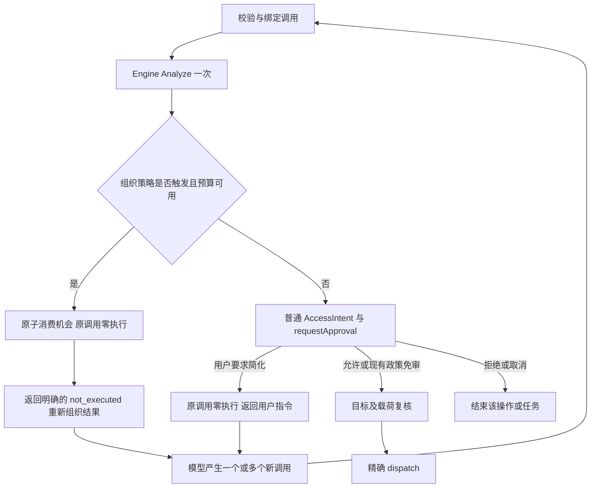

# 可审查命令生成与有限简化设计

> Superseded on 2026-10-28 by [model-declared command effects](../specs/2026-10-28-command-effect-declaration.md). This document records the retired analyzer/organization design; its historical results are unchanged.

日期：2026-10-26
状态：P0/P1、P2a/P2b 首批、P3 基础预览和 P4 已实现。P5 已有 Linux 与 Windows PS5.1/PS7 真实模型证据；人工 UI、其余平台及更大样本仍待验收，默认 off。
实施计划：[分阶段实施与验收](../plans/2026-10-26-reviewable-command-generation.md)。

实际结果见 [P0/P1 验收记录](../evidence/2026-10-26-command-generation/README.md)：提示调整出现局部改善，但原始代码统计问题仍未解决；分析器、授权和审批机制保持不变。本设计中的后续能力不能视为当前产品保证。

后续 [P1 失败分析与精修](../evidence/2026-10-26-command-generation-refinement/README.md) 补齐了 minimal 的查询决策提示。最新对照中日志计数、minimal 代码统计有改善，但 normal 物理行数和 CSV 聚合仍有失败/新增审批，不能视为整体问题已解决。

[P2 首批验证](../evidence/2026-10-26-command-generation-p2/README.md) 固定这些历史模型输出重放：52 条 shell 调用中只有 3 条 Import-Csv 求和从 ask 变为 allow，其余 49 条决策保持不变。提示词、审批 UI 和简化机制未改动；这是分析与授权决策对照，不是新一轮模型完整任务成功率。

[P2b 第二批](../evidence/2026-10-26-command-generation-p2/PROJECTION.md) 支持由审计过的 Measure-Object 输出读取静态标量属性，并修复 bridge UTF-8 编码。该能力不扩展到任意对象、顶层缓存赋值或 .NET 方法；原 52 条历史调用没有进一步审批减少。

## 1. 目标与基本决策

目标是让 AI 在生成操作时就优先选择只读、可由分析器证明且便于人类理解的方式，尽量减少用户需要处理的命令审批，同时以较少的模型往返正确完成任务。减少审批是主要体验目标，不能只把复杂命令转交给用户，再依靠更好的审批界面解决问题。

在任务完整性、结果正确性和现有授权边界不变的前提下，优先减少实际副作用和不必要审批，再降低必要审阅的理解成本，并兼顾模型往返、调用数和耗时。多一条清楚且可证明只读的命令、但能避免一次原本不必要的人工审批，通常优于一次未知效果的大型脚本；这不构成按文件机械拆分的理由。

对于可由现有受支持读取/聚合能力完成的纯查询任务，验收目标是首次生成即可完成且零人工命令审批。对于确实需要写入的任务，目标是让读取尽量保持免审、写入范围最小且明确，按现有政策只审必要操作。不能用省略用户要求的修改、关闭审查、扩大信任或掩盖副作用换取零审批。

本设计包含四个相互独立的部分：

1. 提示词明确“只读优先、生成时可审查”，约束任务范围和组合方式，减少不必要写入、未知效果、附加报表、嵌套遍历和重复探索。
2. 命令分析提供有界的常见聚合语义，让实际只读且证据完整的操作按现有政策免审；对剩余未知部分给出具体缺口，保留确定性的效果/目标授权。
3. 应用层可对少数新生成的复杂调用请求一次重新组织；原调用不执行，不改变授权事实。
4. 审批界面展示已经证明的行为、尚未证明的部分及完整执行载荷，提供明确的简化/拒绝/取消操作。

发布决策：先交付提示、事实及界面改善，再交付可选择的有限简化。拟新增 `command-simplification: off | once`，首次发布默认 `off`；`once` 通过评测和真实交互验收后才可以在独立变更中讨论成为默认值。这里的 `off` 仅关闭自动重新组织，不关闭只读优先的生成指导、普通审批、结构提示或用户主动要求简化。P1 不增加该设置，P4 才增加；不新增同名 CLI flag。

实施状态（2026-10-27）：P4 已按保守子集实现，配置仍默认 `off`。只针对请求级一次反馈，不改变授权。P5 的 Linux 真实模型 A/A1/B/C 对照已完成：C 组 40 次完成会话（180 次总运行）中自动重组为 0，相对 B 没有可观察净收益；物理行数任务仍因只读 `wc -l` 的语义错误失败。默认值保持 `off`；Windows/macOS/PowerShell 和人工 UI/审批仍未验证。具体实现边界见 [P4 记录](../evidence/2026-10-27-command-generation-p4/README.md)，评测与限制见 [P5 记录](../evidence/2026-10-27-command-generation-p5/README.md)。

2026-10-28 Windows 补充：真实 PS5.1/PS7 的 B/C 各 normal+minimal、每场景 5 次已运行。C 共 80 次完成实验（360 次含首轮运行）出现 3 次 typed 自动重组，均在 PS5.1 physical-lines；2 次随后正确且零审批完成，1 次替代仍 unknown 并失败。PS7 没有触发，宿主/模式间效果不一致，尚不能证明稳定净收益，默认继续 off。实际序列的模拟 dispatch 重放验证原调用零分发和替代重新授权，但原始会话未记录逐调用 dispatch 事件。人工 UI 由用户暂缓，Windows race 因 CGO/gcc 条件缺失未完成；不能据此宣称 P5 整体验收完成。完整数据与范围见 [Windows 证据](../evidence/2026-10-28-command-generation-p5-windows/README.md)。

这不是严格的“所有命令必须易懂”保证：提示不保证模型遵守，静态分析不覆盖任意程序，用户仍可在完整审阅后允许未知效果的调用。若未来要求永久禁止某类载荷，应另行定义执行策略，不把一次简化预算伪装成安全边界。

## 2. 基线、问题与现有政策关系

### 2.1 观察基线

2026-10-26 的 HEAD 为 `33dd565`；工作树另有正在进行的 Windows 验收相关修改。本设计依据当时可读取的工作树，不宣称该 HEAD 单独包含所有观察结果。实施前记录提交、工作树补丁指纹、平台和测试环境，不能用本设计的版本号替代实验记录。

已确认的当前行为：

- `internal/prompts/prompts.go` 鼓励合并共享输入的读取/聚合，`ScriptPolicy` 允许复杂逻辑使用可读脚本，尚未定义清楚的组织边界。
- `internal/app/request_session.go` 只记录 `HasReviewabilityConcerns()` 的日志，原始参数随后进入普通审批。
- `internal/commandanalysis/command_constraint.go` 在 `StaticRead && EffectRead` 时跳过关注；其他情况下多个顶层动作也可能触发关注。该函数不能直接作为自动简化判定器。
- `readonly_ps.go` 对控制流及未建模方法保持保守。识别 `ForEach-Object` 名称不等于理解内部任意程序。
- `review_presentation.go` 已展示角色化目标和部分 diagnostics，但 unknown 常退化成重复的 write-coverage 提示。
- `review_pages.go` 已有分页、控制字符转义、窄终端限制和浏览完整内容后的批准条件；不存在“从零添加分页”的任务。
- `TestRelatedStaticReadsExecuteAsOneCall` 已保护多个相关静态读取合并执行；该能力应保留。

### 2.2 用户样例

用户请求：`mods 统计代码行数`。生成命令如下，作为不可改写的回归输入保存到未来测试夹具；测试不得执行它扫描开发者真实工作区。

```powershell
$exts = @('.go','.ts','.tsx','.js','.jsx','.py','.rs','.java','.c','.cpp','.h','.cs','.rb','.sh','.ps1','.sql','.yml','.yaml','.json','.md','.html','.css')
Get-ChildItem -Recurse -File | Where-Object { $exts -contains $_.Extension.ToLower() -and $_.FullName -notmatch '\\\.git\\' } |
  Group-Object { $_.Extension.ToLower() } |
  ForEach-Object {
    $lines = 0
    $files = 0
    foreach ($f in $_.Group) {
      $files++
      $c = (Get-Content -LiteralPath $f.FullName -ErrorAction SilentlyContinue | Measure-Object -Line).Lines
      if ($c) { $lines += $c }
    }
    [pscustomobject]@{ Ext = $_.Name; Files = $files; Lines = $lines }
  } | Sort-Object Lines -Descending | Format-Table -AutoSize
```

问题分别属于不同层：

| 观察 | 归属 | 不能采用的修复 |
| --- | --- | --- |
| 自行扩展为多文件类型、分组、排序报表 | 任务范围/生成质量 | 将所有统计固定拆为多个命令 |
| 嵌套遍历、累加器、方法调用及动态读取来源 | 结构与语义支持 | 仅按命令长度放行，或给整个命令名免审 |
| `SilentlyContinue` 隐藏失败 | 结果完整性 | 少计后仍宣称统计完成 |
| `Measure-Object -Line` 不能直接声称包含空行的物理行数 | 统计口径 | 以命令退出成功替代独立正确性检查 |
| unknown/incomplete 后只能人工阅读整段源代码 | 审批可理解性 | 把模型用途说明当作已证明效果 |

此前在本机 PowerShell 7.4.14 的最小检查中，`'alpha','','beta' | Measure-Object -Line` 返回 2。该观察只说明这组输入的行为，不替代 PowerShell 5.1/7 的文件读取、编码和换行夹具。原样例未在真实项目上执行，也未做真实模型 A/B。

### 2.3 与当前约束的关系

当前 AGENTS 和现行设计规定“复杂度仅用于诊断、不产生纠正结果”。阶段一、二可在该边界内实现提示、分析和展示。有限简化属于明确的后续政策变更，只有实现对应阶段时才同步更新该条、历史设计的取代说明和分发测试。

保留以下现行约束：

- `requestApproval` 是唯一授权入口，`commandResultToIntent` 是生产命令授权适配器。
- `Result.Targets` 和证据决定授权；`KnownDirs`、解释、复杂度、源码长度和用途标签不能授权。
- 未知效果/不完整写目标不能借用临时目录、保存规则或已知读路径取得写权限。
- 外部及动态路径的已证明读取保持现有政策；不能为了 UI 引入新的读取审批。
- 不恢复 LLM 效果分类、不增加分析器内的模型请求、不建立另一套解析器或命令白名单。
- 写目标重验证、原生文件工具 prepared access、秘密绑定、超时和 UAC 顺序保持不变。

关联文档：[当前命令分析架构](2026-10-23-command-analysis-catalog-design.md)、[授权重构](2026-10-22-command-approval-refactor-design.md)、[历史可审查性设计](2026-08-07-command-reviewability-design.md)、[执行评测](2026-10-18-agent-execution-efficiency-evals.md)。历史文档不能覆盖本文明确描述的新提案，也不能把未实施提案当作现状。

## 3. 责任边界与非目标

| 层 | 拥有的责任 | 不拥有的责任 |
| --- | --- | --- |
| prompts / 工具描述 | 只读优先、选择可分析的表达形式、最小充分结果、合并和拆分原则、失败说明 | 自行认定免审、证明只读、动态授权、控制简化预算 |
| commandanalysis | 复用一次 AST/IR，生成效果、目标、结构事实、原因和源位置 | 判断用户是否想要报表、请求模型改写、决定可否批准 |
| app 组织策略 | 结合事实、来源、请求状态和设置决定是否给一次反馈 | 修改命令字符串、模拟执行、降低 Effect/Coverage |
| approval | 模式、规则、临时豁免及明确用户选择 | 把简单/已简化标记当权限 |
| app 审批展示 | 事实、未知、源码、上下文、交互及内容复核 | 用自然语言摘要替代原始执行内容 |
| tools / stream | 原调用或新调用的精确分发、真实未执行结果、取消和结果关联 | 自动执行被替代的原调用、悄悄重试副作用 |
| evals | 正确性、结构质量、执行/审批/往返计数和人工评估 | 用低调用数抵消错误数字或越权 |

非目标：通用 Shell/PowerShell 静态验证、操作系统沙箱、自动安装统计程序、通用脚本执行新工具、任意表达式 DSL、通用事务批处理、跨会话执行信任、数据库迁移、所有现有脚本的强字节快照执行。

## 4. 提示词改动

### 4.1 内容归属

- `ToolSelectionGeneral`：只读优先、最小充分结果、复用证据、一次合适的能力查询、结束条件。
- `ScriptPolicy` 与命令工具描述：优先选择效果可分析的形式、可保留的管道、需拆开的依赖/副作用、脚本来源与完整审阅。
- POSIX/PowerShell 指导：平台调用方式、必要管道、字面参数和 `cwd`，不复制整段通用政策。
- `identity.md`：最多补充“重新组织反馈不代表授权；拒绝/取消不能重试”的运行语义，不加入结构教程。
- `workflow.md`：只在已有验证/范围原则不足时微调，不写命令目录、统计流程或专用行数算法。
- `minimal`：短系统提示共享 QueryPolicy，工具描述承担具体命令组织和语义；保留简短回答样式，不注入完整工作流，也不改变授权或简化预算。旧实现曾跳过全部工具选择指导，P1 精修已用实际组装测试覆盖这一差异。

### 4.2 拟定语义

以下为实施时压缩英文文案的语义规格，不要求逐字复制到所有层：

1. 默认返回用户所需的最小充分结果；不要自行添加分类、排序、图表或辅助报表。用户明确要求的明细必须保留。
2. 能通过读取完成的任务默认使用只读操作；优先已有只读结构化工具、原生命令的只读多操作数形式或效果可分析的清楚管道。不要为查询顺手创建脚本、重定向输出到文件、安装依赖或修改环境。
3. 允许“读取/枚举 → 过滤 → 投影 → 汇总”共享一个调用，允许少量相关独立读取合并；不要为减少调用引入嵌套遍历、状态机器或动态求值。
4. 当下一步需要查看结果，或修改具有独立副作用/授权边界时拆开；保持查询与必要写入的边界清楚，避免将可免审读取与写入混成未知效果的大调用。不要按每个文件、扩展名或管道阶段拆分。
5. 总量和明细复用同一份采集数据，并由工具计算；不要心算补总数，也不要无理由重复扫描。
6. 已知能力直接使用；只有一次批量可用性查询能够避免明显复杂实现时才查询 `runtime_info`。不逐个试工具，不为简单任务安装依赖。
7. 不为缩短审批文本把代码藏入 `-c`、编码参数或临时脚本。必要脚本保留完整可审内容；现有脚本按原样调用。
8. 不隐藏影响结论的错误。部分完成、过滤范围、忽略项和统计口径应如实说明。
9. 重新组织只替代尚未执行的调用，不重做已成功操作；用户拒绝或取消不是重新组织许可。
10. 在能同样正确完成任务的方案中，优先直接程序与字面参数、已知可分析的读取/聚合形式，避免不必要的解释器载荷、嵌套宿主和动态求值。命令可审查性应在首次生成时考虑，而不是等待审批失败后再修补。
11. 用户要求的写入必须完成：先用必要的读取确定目标，再使用明确目标的最小写入和适当验证。不要为了少审批把构建、测试、安装或脚本执行声称为只读；实际效果由运行时判断。

“一个清楚目的”不能作为唯一标准：代码统计可以是一个目的，却包含任意复杂程序。也不设置“一条命令最多 N 个字符/行/管道阶段”的模型指令。

### 4.3 口径与可选工具

常驻提示不硬编码统计 Go 文件、只看 Git 已跟踪文件或忽略 Markdown。对未指定口径的低影响读取任务允许合理假设并在结果中说明；存在显著成本、覆盖差异或用户已经规定口径时不得擅自替换。

若已有专用程序能够更准确完成任务，允许使用并审核该程序的实际命令语义；不能仅因它叫“统计工具”就添加 name-only 只读规则。技能中的现有脚本也不因技能来源而自动获得效果证明。

### 4.4 以减少审批为目标的生成选择

模型应在提交调用前完成一次内部选择：任务是否需要写入；已有读取工具能否完成；相同结果是否有更清楚、可分析的表达形式；合并是否引入了不必要的副作用或不透明结构。这是生成指导，不新增一次询问用户、规划工具或分析探测调用。

| 任务/选择 | 生成要求 | 预期审批体验 |
| --- | --- | --- |
| 查找、读取、统计、简单日志汇总 | 优先只读结构化工具或受支持的数据管道，不产生无必要临时文件 | 支持范围内以首次完成、零人工审批为目标 |
| 同一批文件的总量与用户要求的明细 | 复用一次采集与工具内聚合，不为每个维度重新扫描，也不额外编写大型报表程序 | 同时减少调用和因复杂结构引起的审批 |
| 一条未知效果脚本与少量可证明只读查询结果等价 | 优先后者；保留可合并的读取，不按文件逐个调用 | 接受适度调用增加以减少不必要人工介入 |
| 查询后修改配置、下载或批量更新 | 读取发现目标，使用明确的最小写入；已有结构化批量能力可按真实授权范围组合 | 读取尽量免审，必要写入清楚审批，避免一个文件一次无意义确认 |
| 已有构建、测试、安装或复杂脚本 | 按用户目标使用，不凭用途认定只读，也不拆坏正确执行语义 | 承认必要审批，重点减少附带操作和解释负担 |

提示词只说明通用选择原则和工具已声明的能力，不把完整分析器规则表塞进上下文，也不要求模型每次查询解析器支持情况。对未知形式不得承诺免审。实际只读、能够证明只读、用户易于理解分别评测，三者不互相替代。

避免无必要临时文件不等于禁止所有中间结果：大规模或昂贵采集确实需要保存快照时，应比较重复执行与额外写入的成本，使用明确的最小目标并保持普通授权。临时目录豁免不是优先制造写入的理由。

减少审批必须来自选择效果更小、可证明的等价操作，或改善真实语义证明；禁止建议 `review-mode=never`、扩大只读信任名单、压缩/编码载荷或反复尝试不同拼写以躲开审批。分析器未证明时，按现有政策审阅，不能相信模型自称“只读”。

## 5. 命令分析改动

### 5.1 结构事实与策略分离

在现有 `CommandReviewability` 周围增加或细化有界结构元数据。拟定字段/原因名是接口草案，实施时可调整命名，但必须保留以下语义：

| 事实 | 语义及用途 |
| --- | --- |
| 控制流嵌套深度、循环/分支节点 | 区分单层映射与多层控制流；附节点位置 |
| 有限局部赋值/累加器数量 | 只计 AST 中真实局部状态，不以 `$` 字符数量计数 |
| 动态求值、内联解释器载荷、嵌套宿主 | 显示真实执行层次，不把一条 argv 视为天然简单 |
| 已建模聚合/映射与未建模部分 | 将已证明的数据管道和未知子树区分 |
| 输入来源、转换、输出节点关系 | 仅描述有证据的数据流，不声称解析了所有变量值 |
| 缺口 code、source span、相关 node ID | 让 UI 指出“哪一部分无法证明”，而不猜测写入 |

结构数据不含用户意图判断，不读取外部脚本正文，不触发 filesystem/Git/network 扫描。沿用现有大小、节点、时间和递归预算；新增遍历必须有界并复用解析结果。解析器失败、取消或预算失败不应被重写反馈吞掉。

对无位置的旧结果显示命令级原因，不能编造行号。PowerShell 缺失关键 IR 字段时不猜测，不升级为 read。新增结构字段必须补 Clone 深拷贝和确定性/兼容性测试。

### 5.2 首批语义支持集合

先为支持集合添加独立正反例，再修改授权语义。以下是允许逐项实现的候选集合，而非声明当前均已支持：

| 形式 | 可支持边界 | 必须保守的反例 |
| --- | --- | --- |
| 文件枚举 + 属性过滤 | 已审计的文件来源、静态字段和纯比较 | 任意对象 getter、命令替换、provider 副作用 |
| 投影 + 分组 + 计数/求和 | 静态属性名、明确 cmdlet/程序与参数绑定 | 动态属性表达式、未知选项、外部代码回调 |
| 单层逐项读取 | 已证明来源到已审计读取参数的数据绑定；全体子节点有证据 | 子块混入写入、启动进程、网络或嵌套循环 |
| 局部常量、少量纯数值状态 | 明确作用域和受支持表达式；不能污染执行上下文 | 环境变量赋值、引用副作用、任意对象方法 |
| 字符串转换 | 能证明接收者和具体方法语义后单独审计 | 仅按 `ToLower` 等方法名做全局放行 |
| 多操作数查询、有限列表读取 | 沿用已有 catalog 和 bounded-query 能力 | 同一名字在不同执行空间继承错误语义 |

不以样例最终变成只读作为必达目标。样例保持 unknown，但模型生成更简单且正确的表达形式，也可以达到产品目标。任意 `foreach/while/if`、复杂累加器、外部脚本效果推断和动态写入覆盖不在首批范围内。

### 5.3 授权与证明不变量

- 未知兄弟节点、未知选项、写入、重定向、后台执行不能被外层聚合掩盖。
- 已证明的动态读取不因路径未枚举而自动成为未知写；反过来，知道读取来源不证明全命令只读。
- candidate、未解析表达式与真实写目标分开；保留非 nil 的空写组。
- 每次 Analyze 的环境/文件系统查询保持新鲜，不复用可变查询结果。
- 不执行被分析的命令来确定它是否只读，不把解释器代码作为探测程序启动。
- 写授权继续只消费角色化目标和 coverage；新结构/解释字段不得进入 RulesAllowIntent。
- 语义扩展修改 catalog 兼容修订和测试说明，新增观察快照，不覆盖原始平台基线及 `catalog_legacy.json`。

## 6. 有限简化机制

### 6.1 定义与首批范围

简化是“对尚未执行的调用请求重新组织”，不保证命令更短，也不表示危险性降低。模型应保留用户范围、数据口径、错误处理和已完成工作。运行时不做字符串切割，不自动将 Shell 重写成脚本，不生成替代命令。

首批自动候选限于内置命令工具的、可解析的模型新生成内联载荷。外部 MCP 仅有 `ShellExecution` 声明仍不足以参加自动重新组织，首期只展示已有事实并使用普通审批。必要时以后增加明确契约。

来源由 app 记录，不能相信模型自填 `generated=true` 或脚本路径位于临时目录：

- 模型提供的内联命令通常是候选；如果当前用户明确提供了要原样执行的载荷，或当前消息包含与命令相同的完整文本，保守排除自动改写。
- 对“明确要求原样执行”的识别不能靠分析器猜自然语言；如调用上下文无法可靠区分，归为来源不明，只提供人工简化。
- 所有脚本文件调用首期均排除自动改写，包括本轮生成的临时脚本。是否生成于本轮可用于 UI，但不用于效果授权。
- 后续若扩展到本轮生成脚本，必须由成功的原生文件写入记录、规范路径和内容指纹证明来源；未知来源、外部写入或内容变化后不能继承该标记。

这项保守来源策略可能漏掉部分复杂调用，但不会把现有用户/技能脚本拆坏。来源标记不是权限标记，也不能被用来自动批准未知脚本。

### 6.2 自动触发条件

同时满足以下条件才返回一次自动反馈：

1. 设置为 `once`，review mode 为 `auto` 或 `always`；无论 normal/minimal 均一致。
2. 属于上一节的候选，输入有效、分析成功且未取消。
3. 整体仍为未知效果或含未证明效果；单纯“写目标不完整”不够触发。
4. 结构上存在至少一项高置信组织问题：未建模的嵌套控制流；控制流与多个可变局部状态共同存在；动态求值/多层宿主隐藏了新生成载荷。
5. 已有足够原因生成具体改写指导，且本用户请求尚未消耗自动机会。

“多个可变局部状态”首个可测规则为至少两个不同的局部赋值/累加器目标，且同时含未建模控制流。该阈值仅控制组织提示，不授予权限；与嵌套深度至少二的规则一起纳入误触发评测。

不自动触发：已证明只读、只出现一个未知命令、普通构建/测试/安装、长字面 argv、多条简单读取、常见过滤脚本块、受支持单层读取映射、单纯缺少程序、解析失败、用户指定的现有脚本。

显式信任已使调用按当前政策成为读取时，也不额外触发组织关卡。复杂性仍可被记录，但不能用此项悄悄改变已有读免审语义。

### 6.3 运行位置和状态机



组织决策属于 app，不进入 Engine。先保证模型需要的调用有效和分析结果可用，再给反馈；不抢在已知取消/错误前制造“简化”。原调用返回后不保留任何待执行队列，不在新调用成功后补跑原调用。

状态对象属于一个用户请求，概念字段为 `requestID / automaticUsed / closed / feedbackCallIDs`。创建于真正接收新的用户任务，不创建在 `toolResultCaller()`、`buildRequestSession()` 或每个 provider 工具轮次中。

生命周期规则：

- 同一请求内的模型续轮、API 重试、checkpoint 恢复、registry 重建、换工具名、命令文本变化均不重置预算。
- 预算消费是单调的，恢复旧 checkpoint 不退还；并发调用最多一个获得机会，其他调用走普通授权，不声称整个工具组具有事务性。
- 新用户输入开始新请求；旧请求先取消/关闭，旧回调不能消费新请求的状态。
- 请求完成或取消后销毁内存状态；进程重启后的新请求重新开始，不自动恢复执行挂起调用，不新增会话数据库表。
- 用户在审批中主动选择简化是明确的人类指令，单独计数，不退还自动机会。每次选择只返回一次反馈；模型后续重复同一调用不自动再次反馈。
- 同一请求中任何后续写入仍受既有审批和拒绝语义约束。组织功能不承担新增的自然语言“同一操作”识别系统。

### 6.4 结果传输与错误分类

现有 `stream.CallTool` 用 `err != nil` 生成 `IsError`，协议没有独立的“未执行，需重新组织”分支。首期采用有类型的控制错误及版本化 JSON 文本，不伪装成成功执行，也不为此重构全部 provider：

```json
{
  "type": "mods.command_reorganization",
  "version": 1,
  "status": "not_executed",
  "reason_codes": ["nested_control_flow", "stateful_aggregation"],
  "automatic_remaining": 0,
  "guidance": "Preserve the requested scope. Prefer one collection and a clear aggregation pipeline. Do not split by file or hide the same code in a script."
}
```

该调用仍产生正确匹配原 call ID 的工具结果，`IsError=true` 表示执行请求未完成；活动面板将其归类为“等待重新组织”，不计入进程失败，不显示 exit code，不触发自动 API/工具重试。实际执行次数为零。

不要仅把旧错误改个名字：真正差异是窄触发、全请求一次、具体原因、明确后续普通审批和完整展示。离线评测保留历史 `failed_tool_results` 口径，新增自动/人工重新组织计数及真实执行失败计数；不得把总失败变少作为包装结果后的收益。

JSON 文本不是授权凭证。在线分类以本地类型/事件为准；离线报告以可信测试事件或明确标记的会话控制结果为准，不能通过任意工具输出含某个字符串就认定简化已发生。

### 6.5 模式与边界矩阵

| 情况 | 自动简化 | 后续行为 |
| --- | --- | --- |
| `off` + auto/always | 无 | 现行授权，附改进后的解释和人工简化选项 |
| `once` + auto/always + 候选 | 本请求最多一次 | 原调用零执行；后续未知仍需审批 |
| `never` | 跳过 | 保留显式关闭审查语义；记录结构不阻止执行 |
| minimal | 与 normal 相同 | 不因简短回答取消运行时保护 |
| 非交互 + `once` | 最多一次 | 仍未知则返回 review unavailable；不降级为 never |
| 无法解析/分析被取消/预算失败 | 无 | 沿用对应错误或保守审批路径，不吞错误 |
| 已有规则或临时目录 | 不补授权限 | unknown/incomplete 仍不能借用规则 |
| 用户 N / Ctrl+C | 无修复性反馈 | N 按现行拒绝语义，Ctrl+C 取消任务 |
| 显式文件脚本/来源不明 | 不自动改写 | 内容展示能力允许时展示，普通授权 |

## 7. 审批界面改动

### 7.1 信息层次

按照“执行对象与上下文 → 已证明事实 → 未知及原因 → 完整载荷 → 授权选项”展示；保留读/写/candidate 的角色区分。`cwd` 始终是执行上下文，不能展示成默认写范围。

对原样例的概念展示如下，只有相应事实真实存在时才显示：

```text
Review                          Unknown effects
Working directory: C:\project
Recognized operations: enumerate files; filter; read file contents; aggregate
Unresolved read source: $f.FullName
Analysis limits: nested control flow; unmodeled expressions [source locations]
Effect: cannot establish whether additional side effects are present
Authorization: this invocation only; no reusable write rule
Source: [complete numbered command, paginated]

Y Allow once   S Simplify   N Deny   Ctrl+C Cancel task
```

“识别到读取操作”不显示为“整个命令只读”；“没有已确认写目标”不显示为“没有写入”。未知效果与已知写入但覆盖不全应使用不同文案，避免重复两行同义 coverage 警告。

自然语言用途说明如未来加入，必须标为“模型说明”，与系统事实分栏；首期不新增模型 justification 参数，也不调用第二个模型生成安全摘要。

### 7.2 简化交互

`reviewResponse` 从单个布尔值扩展为明确的 approve / deny / simplify / cancel 结果；零值保持拒绝，未知枚举不得按允许处理。S 仅在可返回重新组织结果的命令调用中显示；原生文件操作不出现不适用选项。

cancel 是交互语义，不要求把现有取消通道改成普通工具响应：保留 `reviewCancelMsg` 和任务取消传播，不能先释放一个可重试的工具错误再取消。新增枚举不得破坏当前阻止模型在 Ctrl+C 后继续执行的顺序。

- Y 和会话授权仍受全页浏览限制；S、N、Ctrl+C 不要求先读完全部页面。
- S 不是批准，不写规则，不启动命令，不改变原始参数，返回一次带“用户要求”的重新组织结果。
- N 不等价于 S，不能把用户拒绝自动改写成另一个执行尝试。
- `Allow for session` 继续只由完整的真实写目标决定，未知效果界面不得出现。
- 增加 S 后重新计算分页控件高度、焦点移动与窄终端行为；缩放、内容更新后重新计算已读范围。
- 完整载荷必须可读取；单页概览不能使尚未展示的载荷页被计为已阅读。分页只证明内容已呈现，不声称用户已经理解。

短命令预览函数只用于概览，完整页必须由原始结构化参数产生，逐项保留 argv 边界和源码换行，不能把 `ProcessCommandPreview` 等展示拼接结果当作唯一可审内容或重新执行的输入。任意来源的源码均是不可信显示文本，控制字符转义仅影响显示，不修改真正执行的参数。

### 7.3 文件脚本内容展示与复核

首期为能明确解析为本地字面脚本文件的调用增加有界只读预览。准备发生在 app/tools 的载荷准备层，使用普通路径读取规则；分析器本身不读取脚本正文，也不从正文推断任意语言效果。

预览对象包含：实际解释器绑定、完整 argv、cwd、脚本规范路径、原始字节摘要、大小、显示编码、源码行和来源证据（如果有）。摘要只用于识别变化，不作为安全证明。秘密只显示引用/遮罩，不能复制明文到源码预览或日志。

首期建议预览上限 256 KiB，读取时间与取消有界；该上限属于资源保护，不是代码质量标准。超过限制、二进制/不支持编码或不可读时明确显示原因。可以分阶段交付：

1. **基础预览模式**：显示可得内容，执行前重新读取并比较路径身份/字节摘要。发生变化最多重新准备和审批一次，持续变化则停止。现有外部脚本内容不可得时保留普通未知程序审批，并明显注明“未审阅脚本内容”，不称其完整脚本审阅。
2. **完整载荷模式**：仅在全文可展示、上下文可绑定时使用该名称。对于本轮生成、可追踪的脚本，缺失全文或变化无法复核则不提供误导性的完整批准，允许简化或取消。

源码预览只在本来需要人工审批的调用准备，不为已免审读取额外打开审批，也不在 ReviewNever 下增加内容审阅阻断。预览读取使用独立的短时准备预算和请求取消；实际命令 timeout 仍在授权之后开始，UAC 仍发生在普通效果/目标授权之后。

载荷变化复核与现有目标变化复核共享一次重新准备/审批上限，不能分别重置计数，造成目标和内容交替变化时无限审批。新内容不能沿用旧的已读页状态。原始字节用于摘要，显示解码必须明确支持范围；替换无效字节后不能声称展示了完整原文。

执行前摘要复核仍有检查到使用的系统调用竞争窗口；它不等于执行不可变字节快照。首期不对任意脚本声称“执行字节必然等于展示字节”，也不静默复制到临时目录执行：复制会改变 `$PSScriptRoot`、`__file__`、相对导入、文件签名等语义。

强快照执行是单独的后续研究项：只有特定解释器/平台存在保持调用语义的受支持执行绑定时才扩展。读取入口脚本永远不代表冻结导入文件、子进程、网络或文件系统。这一限制必须在发布说明和界面说明中准确表达。

## 8. 降低往返与批量操作的边界

先使用已有多操作数命令、结构化工具及数据复用，不在首期新增 `process_batch`、通用脚本工具或专用代码行数工具。

评测分别记录模型工具轮数、工具请求数、真正 dispatch 次数、子操作数量（可得时）及审批次数。少量简单调用不应被错误评为比一个大型脚本更差。

只有真实瓶颈证明确有需要才另提批量设计，至少具备：逐项字面参数/结果/授权、明确顺序和依赖、取消及部分失败行为、项目上限、不共享隐式 shell 状态。已批准一项不得覆盖其他项，批次不是事务。新工具需通过 `builtinTools()` 单一注册表和 prompt budget 检查。

## 9. 评测与验收原则

### 9.1 评测层次

1. 确定性单元/性质测试验证分析、规则、预算、状态和零执行。
2. app 分发/审批测试验证真实生产适配器、目标复核和交互结果。
3. 平台真实解析与隔离执行测试验证 PS5.1/PS7/POSIX 差异，恶意或未知反例只解析/模拟分发。
4. 固定模型的真实生成评测验证首次生成、正确性、组织质量和往返；无 key 明确 SKIP。
5. 人工终端验收验证读懂能力、分页、键盘、脚本内容与拒绝/取消。

### 9.2 场景集合

至少包含：原始含糊代码统计、明确物理行/代码行口径、明确多维报表、简单 CSV 求和、日志过滤/汇总、多文件查找、相关 Git 查询、先发现再修改、下载批次、构建测试、现有技能脚本、生成临时脚本、编码/嵌套载荷、读取失败及部分结果。

统计夹具包含空行、注释、CRLF/LF、无末尾换行、空文件、带空格/中文/特殊字符路径、忽略/未跟踪文件、依赖/生成目录、多语言、不可读或读取失败文件。独立期望由可信夹具生成，不靠模型脚本验自己。

含糊任务与明确任务分别评分：前者允许若干合理口径，但必须说明且按所声明口径正确；不能只认可 Git tracked Go。后者必须满足用户所有明细，不能为简洁省略要求。

### 9.3 指标与对照

记录每次提交与补丁指纹、真实模型标识、参数、prompt mode、review mode、简化设置、工具集、平台/解释器、技能/配置来源、耗时、实际 token usage（不可用则为空）。

主要体验指标是纯查询任务的零人工审批完成率，以及每个任务实际呈现给用户的命令审批次数。两者必须同时报告正确性和完成率，任务失败、被取消或遗漏结果不能记为零审批成功。写入任务单独报告，不将必要写入审批视为生成失败。

补充指标：首次生成的读取调用获得确定性只读证明的比例；实际仅查询但因未知效果产生审批的比例；首次生成符合组织规则比例；unknown 原因分布；自动及人工简化次数；真实 dispatch 与失败次数；工具轮数/调用数；重复采集；未读取/部分结果报告；人工理解评分及审阅页数/耗时（可观测时）。静态证明只读不能代替人工可理解评分。

审批计数以实际展示事件为准，包含内容/目标变化后的重新审阅；S 所在的审批页也是一次用户介入，不能算成无需审批。记录执行授权来源：静态只读证明、显式信任、保存规则、临时目录、用户批准、never，防止把换了权限设置误计为生成质量改善。非交互的 DecisionAsk 只作为“预计需要审批”单独报告，不能当作实际用户看过审批。

主要对照：现状 A、只修改生成指导的 A1、提示+分析+界面 B、B+once C。A 与 A1 固定同一个分析器/授权版本，直接检验 AI 是否在首次生成时更倾向于只读且可证明的命令；B 才评估语义支持扩展的附加收益。固定同一模型/夹具/模式，交错运行，每个关键场景每组至少 5 次；样本只供初步判断，不能将小样本微小差异宣称稳定提升。normal+auto 为主组，minimal 和 never 为独立对照；非交互 auto 遇未知失败不能当作交互完成率。

确定性安全测试必须全部通过。预先确认可由受支持只读能力完成的查询夹具，其合格生成应按现有授权自动执行、无需人工审批；真实模型记录达到该目标的频率和每次例外，不能通过删除难例改善数字。真实生成必须满足预先登记的正确性要求，且不得用更多漏报或错误统计换取少调用。是否开启默认 once 要额外证明比 B 减少不必要审批或必要审批的理解负担，且没有集中触发现有脚本、增加冗余探测或明显恶化往返尾部；数据不足则保持 off。仅改善审批文案而首次生成和审批次数没有改善，不能称为完成了只读优先的生成目标。

## 10. 交付范围与回退

按提示、结构事实、语义扩展、UI、脚本预览、有限简化、真实评测分别提交；语义扩展与纯展示改动不能混在一起更新快照。无需为了本设计现在改生产代码、AGENTS 或历史验收结果。

回退自动简化时切换 off 即可恢复普通授权路径，解释/分页保留；若语义扩展不可靠，单独回退对应 catalog 修订，不能临时放宽规则。脚本预览失败必须按文档能力边界降级或停止，不使用旧摘要继续批准。

本设计落地前仍需由实验回答：有限规则的误触发率、一次反馈是否减少人工审阅成本、预览资源上限是否合适、哪些窄语义扩展最有价值。它们是有明确实验出口的实施项，不是授权正确性的未决条件。
